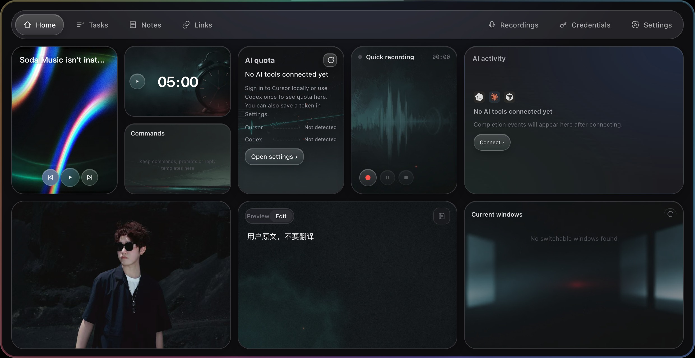

<div align="center">
  
  <h1>Pome Panel</h1>
  <p><strong>A local desktop workspace for Mac and Windows.</strong></p>
  <p>A translucent glass panel with a Bento home screen, tasks, notes, links, recordings and credentials. Collapse it into a small capsule and drag it to any screen edge. It expands from your saved position.</p>
  <p>Based on Todo Panel. Developed by Lando.</p>
  <p><a href="README.md">简体中文</a> · <a href="CHANGELOG.en.md">Release notes</a> · <a href="https://github.com/Sunanang/Pome-Panel/issues">Report an issue</a> · <a href="https://github.com/Sunanang/Pome-Panel/releases/latest">Downloads</a></p>
</div>



Supports macOS 13+ on Apple Silicon and Windows 10/11 x64. The desktop app uses Electron 44. Clipboard history is optional and off by default. The optional NAS companion keeps workspace content in sync across paired devices.

## Language

The desktop app starts in the system language: Simplified Chinese or English, with English as the fallback for other languages. Change it at **Settings → Device & activation → Language**: System, 简体中文 or English. The preference belongs to this device and is not synced to the NAS. Changing the language preserves your content and unsaved form input.

Recording recognition has its own **Chinese / English** setting in API configuration. Changing the interface language does not change recognition, including an ongoing recording or a reconnection. Smart naming follows the language of the note or recording content. Existing titles, notes, task summaries, project names and custom locations are not translated. Dates and numbers follow the interface language and system regional conventions.

The NAS application page also has a language setting. Native NAS install, configuration, upgrade and uninstall pages follow the host language. Windows setup and uninstall use the current Windows display language on each launch; they do not follow the app's manual preference. Only Chinese and English are included. macOS uses a DMG and Finder; there is no separate uninstall wizard. Camera and microphone purpose strings are localized.

The website has [Chinese](https://Sunanang.github.io/Pome-Panel/) and [English](https://Sunanang.github.io/Pome-Panel/en/) pages. English documentation is here; internal development plans and ADRs remain in their original language.

## What is different from Todo Panel?

The repository does not identify a verifiable upstream URL, so this describes only the features in this repository.

| Area | Pome Panel |
| --- | --- |
| Workspace | Bento Home plus Tasks, Notes, Links, Recordings, Credentials and Settings |
| Position | Both platforms support docking at all four edges. Collapse, drag, release to dock. The expanded panel aligns to a nearby corner or centers along the edge. Settings can reset it to the top. |
| Home | Quick recording, Pomodoro, AI quota, AI activity, commands, Markdown notes, mirror and sunrise/sunset. Soda Music is Mac-only; Current windows depends on platform support. Modules can be resized, hidden and rearranged. Layout stays local. |
| Multiple devices | The optional Pome Panel NAS companion in `fnos/` syncs workspace content. Credentials and AI keys travel in encrypted envelopes. |

## Position and controls

The collapsed capsule is approximately `85 × 9` logical pixels at the top or bottom, and `9 × 85` at the sides. Click to expand; drag only while collapsed. Release to snap to the closest edge. Within approximately 120 logical pixels of a corner, the expanded panel aligns toward that corner. The saved position belongs to this device.

The default is top-center, below the macOS menu bar or at the top of the Windows work area, avoiding the taskbar. Every expanded page has a `1240 × 540` content area; the normal window is `1240 × 638`. Switching pages does not resize it. Smaller displays retain a 24px safety margin.

Use the menu bar or tray to show the panel, configure the summon shortcut, enable launch at login, view About or quit. The default summon action is hover + Space. Window bounds change without system animation; renderer animations respect reduced-motion preferences.

## Pages

| Page | Purpose |
| --- | --- |
| Home | Resizable Bento modules. Keep at least one module; the others fill available space when a module is hidden. |
| Tasks | Four renameable workflows, internally still `P0`–`P3`. Defaults are Courses, Media & writing, Vibe coding and Daily life. New tasks default to 23:30 today, sort by deadline and remind you one hour before they are due. |
| Notes | Save Home notes to a searchable library; rename, edit or delete them. |
| Links | Save public HTTP/HTTPS URLs. Title fetching rejects local addresses, private networks and unsafe redirects. |
| Recordings | Audio stays in the local `recordings/` directory. Optional Model Studio Qwen3-ASR live transcription uses an encrypted API key or an environment variable. |
| Credentials | Accounts, passwords and API keys use system secure storage; the page cannot directly read plaintext. New and edited passwords are masked by default. |
| Settings | Language, transcription and smart naming, AI configuration (completion hooks and usage tokens), Display (workspace and Home switches), NAS sync, mirror cover, default page, summon shortcut, dock position, data folder and launch at login. |

Home edit mode swaps cards while preserving their sizes. Packing keeps the swapped pair fixed and may expand other cards to fill holes. If the requested swap does not fit, it reports insufficient space and retains the saved layout.

## AI activity and notifications

Connect **Codex, Claude Code and Cursor** at **Settings → AI**. Preview shows the exact files, Pome hook entries and timestamped backups. Confirmation verifies the backup and writes atomically. Invalid configurations and stale previews are rejected. Only Pome-owned entries change; other hooks, formatting and comments are retained. Existing Codex `notify` commands are forwarded and restored on disconnect. After a configuration change, fully quit and reopen the connected tool.

The local receiver listens only on `127.0.0.1:43821`, at `/notify/codex`, `/notify/claude` and `/notify/cursor`. Other sources return 404. Child-agent completion and cloud sessions do not show notifications.

Hovering pauses timed notifications. Leaving resumes the original remaining time without extending it, so the progress bar does not grow even near expiry. Example:

```bash
curl -X POST http://127.0.0.1:43821/notify/codex \
  -H 'Content-Type: application/json' \
  -d '{"title":"Fixed settings layout","project":"my-project","task_id":"demo","event_id":"demo-completion-1"}'
```

Notifications preserve `completed`, `failed`, `awaiting` and `due` states. Awaiting confirmation does not expire automatically. The bubble shows a source icon, actual summary, source/project, event-relative time, queued count and a hover-paused progress bar. Generated fallback titles follow the interface language. Actual AI summaries stay unchanged; only display is truncated, and the complete stored summary is available on hover, up to 4096 characters. Codex session names are read only by exact thread ID and kept separate from the completion summary; missing names are not invented. If opening an app fails, the bubble shows the reason, pauses its timer and allows retry or close. Windows behavior continues to follow the native-capability setting below.

Home AI activity has four sizes: mini shows the unread count and latest summary; small, medium and large show 3, 5 and 10 records per page. Mini never shows pagination. Other sizes show Next only when more data exists, with Previous and the current page from page 2 onward. A single page hides pagination. New records do not change your page; paging scrolls the list to the top without resizing the card.

Clicking a record marks it read and opens the source application, without trying to locate a particular chat: Codex desktop, Cursor, or a terminal for Claude Code. On macOS, an existing Terminal tab for the recorded `cwd` is preferred; otherwise Terminal opens in that directory. Windows prefers Windows Terminal, then PowerShell. Without `cwd`, it opens a terminal normally. Directories must be existing absolute paths. Missing applications and launch failures show a brief message.

Records are saved before a notification is accepted. Only the latest 100 completion records by reception time are retained, including unread records. New events, startup and reads apply the same limit; age and read status no longer control retention. Deduplication data is removed with evicted records, so retries of evicted events may be accepted again. Source completion IDs, or stable task/time/turn identities, deduplicate retries and restarts while allowing later turns. Legacy notifications with insufficient identity are accepted using supplemented time/content, but cannot guarantee deduplication across different delivery times. Old GPT history remains visible as Other; no new GPT integration is installed.

The Home tab shows an unread badge when another tab is active (`9+` above nine), an error marker for damaged data, or a dot if the module is disabled. It is hidden while Home is selected. Clicking it highlights the module or opens its settings. Disabling and re-enabling preserves other module sizes and positions, preferring the previous location and shrinking only AI activity if needed. A disabled module leaves an Add module placeholder.

A damaged inbox requires explicit **Back up damaged file and rebuild** confirmation with the full backup path and consequences. Cancel keeps it paused. Original bytes must be saved and verified before creating an empty inbox. The inbox is persisted in local `userData` and syncs completion history and read marks through the NAS; ordinary workspace backups still exclude it. Source and stable completion identity merge duplicates. Pulled history does not replay notifications, and native windows/directories stay on each device. New events, load and cross-device merges share the latest-100 limit. The NAS enforces the same limit and tombstones evictions so offline copies cannot restore them. First pairing follows the existing local/NAS authority choice. An older NAS companion must be updated to support this collection.

The connector uses Electron's bundled Node runtime rather than relying on PATH. It detects changed install paths and offers Repair. Claude Code uses `hooks.Stop`; Cursor uses official `hooks.json` v1 `hooks.stop` and `hooks.afterAgentResponse`; Grok writes Stop / StopFailure into `$GROK_HOME/hooks/pome-panel.json`, defaulting to `~/.grok/hooks/pome-panel.json`. Session plus `promptId` separates turns while deduplicating retries; subagent and session-teardown events are excluded. Grok keeps its name/icon in bubbles and the inbox, opens via the terminal adapter, and participates in NAS completion sync with the shared latest-100 retention limit. Conversation and generation IDs associate summaries and deduplicate events. Stop-only setups remain compatible and can add the summary hook. Cursor `error` is failed; `aborted` is not reported as success. Summary cache is local and private: 10-minute read lifetime, at most 256 entries and 4096 characters each; entries are removed after stop and expired entries are cleaned on subsequent writes. Transcript reads are bounded. Claude cloud sessions (`CLAUDE_CODE_REMOTE=true`) are excluded. When Grok also loads Claude/Cursor hooks, those sessions are handled by the Grok forwarder.

Settings and Home no longer show **Send test**. The backend test API still uses the same forwarding and receiver path without creating history, unread counts or real completion bubbles. Empty states distinguish unconnected, waiting for the first record and broken connections. Initial detection can be dismissed locally with Later. Scripts: [Codex](scripts/codex-notify.js), [Claude Code](scripts/claude-notify.js), [Cursor](scripts/cursor-notify.js), [Grok](scripts/grok-notify.js), [Copilot CLI](scripts/copilot-notify.js), [Antigravity](scripts/antigravity-notify.js).

Copilot CLI uses `agentStop` and unrecoverable model/system errors from `$COPILOT_HOME/hooks/pome-panel.json` (default `~/.copilot/hooks/pome-panel.json`). Session exit, subagents and recoverable/tool errors are excluded. Current assistant-result IDs deduplicate retries, with timestamped event identity as fallback. Hooks use direct executable arguments.

Antigravity uses the isolated `pome-panel.Stop` entry in `~/.gemini/config/hooks.json`, preserving other hooks. Only fully idle model stops complete; errors or step exhaustion fail. Conversation/execution identity distinguishes turns. The documented event has no answer text, so summaries use the default title. App/IDE opens Antigravity; CLI opens Terminal. Both remain partial: Copilot VS Code/cloud and unverified transcript formats are outside scope. Other blocking Stop hooks can still affect completion timing. Grok Bot completion remains unsupported. Manus completion uses the API polling path below (partial).

### AI attention reminders (development)

**Scope:** Completion reminders can connect Codex / Claude / Cursor / Grok / Copilot CLI / Antigravity. Usage uses each provider’s supported data source. Waiting for input/choice/approval currently covers Claude only (partial). Codex, Cursor, Grok, Copilot CLI and Antigravity waiting observers are not enabled; Pome will not invent waiting states by guessing or polling.

Validated v2 events use the same loopback endpoints and keep input, choice and approval requests separate from completion history. The final blue B design uses a 400×146 macOS window with a 32px black cap and a 384×114 Windows card. Existing completion sizes are preserved. Safe question summaries fit one line; Home → AI activity → Pending shows the complete safe summary. Sensitive content is hidden before persistence.

A sole request stays visible without a countdown. Competing requests and completions rotate fairly with 8-second waiting slots, hover pause and preserved completion time. The bubble `+N` counts every remaining item after the current one (other visible waiting requests plus the completion FIFO); hidden waiting requests are excluded. Body/button clicks return to the source; × only hides this display. Neither resolves the request. A matching source resolution, continuation or cancellation removes it without another notification. The Home Pending entry opens a small list with source-opening, hidden-bubble replay and storage-repair actions. If the AI activity widget is hidden, restore it from Settings → Display → Home. With Windows native capabilities off, clicking only hides and prompts a manual return.

State is local in userData/ai-attention.json, outside LocalStorage, completed unread counts and NAS sync. Source, surface, session, turn and request identities prevent unrelated resolutions; short-lived tombstones suppress late delivery. Restart or source disconnect marks requests unverified without replay. Storage errors reject delivery and provide a confirmed backup-and-rebuild action in the Home Pending list.

Claude setup/repair previews observation-only PreToolUse, PostToolUse, PostToolUseFailure, Notification, UserPromptSubmit, Stop and SessionEnd hooks, retaining unrelated entries. The hooks output no decisions or answers. AskUserQuestion uses tool-use identity; idle_prompt is ignored. Permission/form notifications without request IDs settle only at explicit continuation/end boundaries, not unrelated tool results. Permission notifications may be delayed about 6 seconds. Native request/notification IDs take priority; otherwise each hook invocation gets an observation ID. Re-delivery of that observation within the current turn deduplicates, while a fresh invocation (even the same command) is separate. Without native IDs, repeated source hook invocations cannot reliably be distinguished from new requests, so capability remains partial. Batch resolution commits atomically, hidden requests do not count in +N, and the fixed npm install preview supports English/Chinese prefixes without forwarding commands or arguments. Live Claude verification is outstanding (partial capability). Codex desktop and Cursor IDE waiting observers are unverified and disabled; fixtures do not establish support for existing dialogs. See the [implementation and acceptance record](docs/plans/2026-10-18-ai-attention-implementation.md).

Entire Codex responses that exactly match an empty suggestions/exclude object (optionally JSON-fenced) are filtered. Other JSON and natural-language results survive. The same projection hides historical noise consistently across pagination, totals and unread counts while preserving disk records and dedupe identities. Legacy notify cannot establish a verified explicit user request for this exact JSON, so an intentional same-shaped empty result can still match this narrow rule; an unverified final:true flag cannot override it.

## AI quota

Only detected providers or providers with a configured token appear. The shared catalog covers Cursor, Codex, Claude, Grok Bot, Grok, Copilot, Antigravity and Manus. The B dashboard mosaic shows providers together without tabs. Each provider shows its shortest reported quota window by default (for example, Codex uses five hours before its weekly window). Equal durations retain source order; providers without cadence metadata use their primary bounded statistic. Missing usage in the selected window stays unknown. Ring length and the main number use the shortest window, while colors, urgency and expiry use the minimum remaining quota across all bounded windows. Constrained longer windows use their progress-row severity and actual reset time; missing times are omitted. Depleted quotas use a grey ring, pale red track and struck-through number; mini uses a status dot and one-line summary. Small/medium omit the main window from inline bars and do not duplicate a single-window reading. Large retains real window bars; details retain all windows and warning colors. Hover or click to reveal per-window bars. The mini footer summarizes bottleneck windows and urgent states; click it or press Enter/Space for full details. Non-mini provider names stay on one line, using readable Claude/Antigrav aliases in narrow cells before shrinking or ellipsizing; tooltips and accessible names retain the full identity. Currency balances, credits and unlimited quotas retain their units without fabricated percentages. All provider reset times and Cursor billing-period timestamps use local minute precision while retaining the original timestamps internally; date-only or missing Cursor billing values remain date-only or unknown. Mini shows up to four providers, or three plus +N for five or more providers; small shows the four most urgent providers in equal two-column cells, leaving the fourth cell empty for three providers and showing +N beside its refresh button for hidden providers. Compact sizes prioritize invalid, depleted, critical, low, stale and normal states, sorting equal states by bottleneck remaining; medium/large follow settings order. Medium/large put three or four providers on one row and five or six in a 3×2 grid, leaving empty cells blank. More than six sources scroll inside medium/large cards. Non-mini cells place the icon and single-line name above the centered ring, window bars and time-only footer, without badges or badge lanes. Regular cells center rings below the name and above the window rows; without rows, this space extends to the footer, with no placeholder rows. Medium single-row layouts with three or four providers instead center the ring vertically in the full cell and place rows 10px below it. Large Grok Bot retains its real weekly row aligned with the first row in adjacent cells. Ring diameter is shared across the card: small 38px; medium 72/60/32px for 3/4/5–6 providers; large 140/120/80px, uniformly capped to available physical space. Regular layouts reserve the name, window rows and footer before centering the ring in the remaining space. Medium tall cells keep rows near the centered ring while retaining bottom-aligned footers. Inline Cursor labels use Cur/Oth. Each provider measures its own longest window label and uses a fixed numeric column measured from 100% in the actual font, including tabular figures and letter spacing. Numbers start at its left edge; label/track/value gaps are 3/2px. Each visible label/track/value group is centered independently of unused numeric capacity; changes in digit count smoothly shift the group through the existing animation store. Tracks align within that provider and stay constant during animation; shorter labels in other providers can leave longer tracks. Invalid credentials show a centered dashed red ring and alert with only an invalid/settings footer; the mini invalid summary opens settings. Expired data retains the existing threshold, adds a gray clock and actual age to the header, and dims rings, numbers and rows to about 45% opacity. Hover reveals source, reset and timestamp details; extra windows scroll within each cell. Grok Bot is a separate Cursor Sand pool card (local sign-in or saved Cursor token), distinct from standalone xAI Grok. Layout retains the existing `cursor` module ID.

Credential read, save and clear failures share a dismissible error bar with a repair action and redacted diagnostics. The bar occupies its own region, with scrollable content above it so bottom controls remain reachable. Missing or unreadable local sign-in is distinguished from expired sign-in. Required-field validation stays beside the form; camera failures and layout space constraints use brief notices. Applying and saving a layout clears its matching error; cancellation, unchanged requests and failed saves keep it.

Quota names use Daily quota, Weekly quota, Monthly quota or an N-hour/N-day quota; compact views use Day, Week, Month or 5h. Codex and Claude share cadence names without duplicate labels. Grok Bot uses Weekly quota; Cursor uses Monthly quota with Cursor/Other pools (Cur/Oth in compact rows; API keys remain auto/other) and reset wording instead of billing wording. Copilot keeps premium-request/chat/completion pool names, Antigravity retains model names and known cadence, Grok retains its posted prepaid balance, and Manus retains available credits. Missing cadence is not guessed.

Provider quota limits: Grok requires an xAI Management API key and team ID, and displays posted prepaid USD balance rather than an invented quota percentage. Manus uses the documented /v2/usage.availableCredits endpoint on api.manus.ai with x-manus-api-key and displays data.total_credits as spendable credits, without inferring a percentage from the monthly entitlement. Copilot credentials are scoped to github.com. Antigravity requires measured quota buckets; empty summaries remain unavailable.

Quota is **remaining**, rounded from the original used percentage. A fuller bar means more remains. At ≤20% it is orange; at ≤10% it is red. Unknown remains `--%`; expired samples are dimmed and marked Data expired; invalid tokens use a dashed red state and recovery link. Periods, extra models, plans, credits and timestamps come from actual provider data. Refresh follows visibility and known reset times.

Cursor reads the local login state by default. **Get local token** reads a signed-in Cursor into a password field; Save applies it. Saved tokens take priority, are encrypted locally and sync as encrypted AI configuration. Invalid saved tokens fall back to local login. Network failures retain the same account's last successful value; authentication failure does not reuse another account's cache.

Claude usage uses local Claude Code OAuth. Copilot / Grok / Antigravity accept optional manual tokens via `safeStorage`. Completion HTTP accepts Codex / Claude / Cursor / Grok / Copilot CLI / Antigravity (catalog-driven). Manus completion does not use HTTP: enable “Receive completion alerts” in Settings to poll the official task API using only read calls with the configured key while the panel runs (backfill on next launch). Clicks open the manus.im task page. Waiting for input/approval is not enabled yet.

Manus retains account-scoped pagination checkpoints and terminal candidates across same-account key changes, network failures and normal restarts. Turning collection off and back on starts a new listening period. Discovery, active tasks and older task pages share a request budget and fair scheduling; large accounts and long offline periods increase delay, and arbitrary offline intervals are not guaranteed complete. Completion history shares the latest-100 limit and NAS sync with other sources. Control state retains necessary deduplication identities, while confirmed outbox bodies are removed. Task titles, summaries and synced fields filter sensitive credentials before persistence. The key itself has broader permissions; the panel calls only read endpoints and does not answer, approve or modify tasks.

Codex **Get local token** reads only the access token from local `auth.json` when you explicitly click it; Save encrypts it with `safeStorage`. A saved token queries ChatGPT usage with a short timeout; otherwise bounded local session reads apply. 401/403 marks a token invalid with local fallback; network errors do not. Reset labels use local dates.

## Data, backup and NAS sync

Workspace files stay local: `workspace.json`, `clipboard-images/` and `recordings/` under the selected data folder. New media references use portable relative paths with `/`. System-encrypted credentials may not transfer between computers. Selecting an empty data folder migrates the current workspace; selecting one with `workspace.json` offers to open it after saving the current workspace in its original location.

Clipboard history is off by default. Enable it from the menu or **Settings → Display → Workspace**. It polls locally without claiming a global shortcut and skips password-manager content marked sensitive. Copied credential passwords are marked sensitive and excluded from Pome's history. The mirror starts only on a click and releases the camera when Home is left or the panel collapses. Recording starts the microphone only on request and releases it on stop or exit.

Clipboard history retains the latest 100 ordinary records by copy time. Favorites are retained indefinitely and do not count toward that limit (manual deletion and clear remain available). Local copies, startup, workspace restore and NAS projections use the same trimming rule. Removing a favorite makes it ordinary again and may immediately evict it if it is too old. Overflow after a NAS merge sends deletions back to prevent old rows from returning; image cleanup preserves files still referenced by surviving records.

The single **NAS sync** card is on the right of Settings, between Cover image and local settings. Enter the address and one-time pairing code. Advanced offers one optional external fallback address. The status row shows overall sync time; Details shows each content type's own result and time. Paused sync exposes recovery preview and snapshot rollback in the same card. Pairing tokens use system secure storage, not LocalStorage. Plain HTTP is off by default except for loopback. Untrusted HTTPS certificates require explicit trust scoped to the exact host, port and certificate; certificate validation is never disabled globally.

The companion syncs tasks/categories, notes, links, commands, clipboard, AI completion history, recordings including audio, AI configuration and credentials. Home layout is local. Credentials and AI keys use account-sync-key AES-GCM envelopes; the NAS stores ciphertext. Recording metadata and audio report separately. Missing audio or audio above 6 MiB is not claimed as transferred. Local backups still contain complete oversized audio. An incomplete local copy cannot destructively overwrite complete NAS audio. Note conflicts retain separate versions with stable source/version deduplication, without recursively named copies. Tasks follow actual server-accepted version order; there is no field-level merge.

**Settings → NAS sync** also exports `.pome-backup.zip` without pairing. The v1 manifest includes app version, collection counts and SHA-256 hashes. It covers tasks, categories, notes, links, commands, clipboard and recording media. Restore validates first, snapshots the current data and rolls back failed replacement. Credentials, AI keys, pairing, sync controls, Home layout and system settings are excluded; existing credentials/settings remain.

Restoring on a paired device pauses sync, including after restart. Recovery requires a fresh preview and confirmation of all additions, updates and deletions before replacing NAS data with the local workspace. Changes on either side invalidate the preview. The NAS must persist and read back a verified snapshot, then commit atomically against its version. Sync resumes only after verification. Older companions without snapshots cannot overwrite. There is no pull-and-merge recovery action. The most recent overwrite may be rolled back only if the NAS has had no later changes; rollback creates a new version and keeps sync paused.

The companion persists `sync-state.bin`, `sync-state.bin.transactions/` and `server-id`. Incremental writes avoid repeatedly serializing old audio, with checkpoints every 256 transactions. Corruption, invalid order or checksum failure stops startup and preserves the originals. v3 automatically upgrades v1/v2; old companions cannot read v3 and must not be used to downgrade. Back up all three storage components together; ordinary desktop ZIP backups remain v1.

Acknowledged log prefixes can be compacted. Unacknowledged logs and idempotency results normally remain for 90 days; older cursors must fully resync, and expired requests rebuild against a fresh baseline without reviving remotely deleted items. Snapshots protect the last committed overwrite, the 30-day rollback window and staged operations for 24 hours; other snapshots normally expire after 90 days. After 24 hours a staged operation needs another preview. Set positive `FNOS_SYNC_RETENTION_DAYS` and `FNOS_ROLLBACK_WINDOW_DAYS` to change retention. Checks run hourly during requests or after 256 transactions. Actual content, unread inbox records and deletion markers are not cleared by these cache rules.

## Windows

Fresh Home layouts enable sunrise/sunset and fill the grid with available modules. Untouched old default layouts are repaired; custom layouts and Mac defaults stay unchanged. The city popover avoids panel edges, scrolls long search results and keeps manual location controls accessible. Any collapse closes it on both platforms; reopen it explicitly next time.

Run `windows-x64-setup.exe`. Choose a folder on the installation directory page, for example `D:\Apps\Pome Panel`. Setup creates desktop and Start menu shortcuts to the executable, and manual reinstall repairs a missing desktop shortcut. Default: `%LOCALAPPDATA%\Programs\Pome Panel`. An installation folder contains the executable plus supporting files; use the shortcut to launch.

One-click source setup is preferred. Configuration paths are `%USERPROFILE%\.codex\config.toml`, `%USERPROFILE%\.claude\settings.json` and `%USERPROFILE%\.cursor\hooks.json`. The bundled PowerShell bridge uses `ELECTRON_RUN_AS_NODE=1` and passes notification JSON as data, never as a command expression. It uses the actual install path and writes tool configuration only after confirmation. Mac tests do not replace Windows validation.

**Settings → Windows native capabilities · Experimental** enables Current windows, automatic clipboard paste and notification focus. It is off by default, loads no native module while off and preserves saved visibility preferences. When enabled, it lists current-desktop windows in front-to-back order, excluding tool windows, and restores minimized targets. Paste sends one Ctrl+V without a global keyboard hook. Elevated targets prompt for manual paste; closed or changed targets fall back to Copied. `POME_DISABLE_WIN_NATIVE=1` forces native loading off.

Native capabilities remain off until Windows Defender, Huorong and 360 checks have passed. Unsigned installers may show **Windows protected your PC**: use **More info → Run anyway** only when you trust the downloaded package. Each new unsigned release can trigger it again. Launch-at-login changes may also be reported by security software. Fresh installs enable launch at login; upgrades preserve the existing choice. The setting reads the actual OS state, including Task Manager overrides; uninstall removes the startup registry entry.

Known limitations: no code signing; no following between virtual desktops; Soda Music is permanently hidden on Windows; ARM64 is not tested (only x64 builds/native modules); the 9px capsule can cover the top strip of a maximized browser and overlap the Windows 11 Snap UI. With native capabilities off, clipboard clicks copy only, requiring manual Ctrl+V, and notification clicks only close the notification.

## Run from source

Desktop requires Node.js 18+:

```bash
git clone https://github.com/Sunanang/Pome-Panel.git
cd Pome-Panel
git switch dev
npm install
npm run setup:hooks
npm test
npm start
```

There is no renderer build step. `npm start` runs the complete Electron desktop app. `dev` is the long-lived development branch; `main` only receives `dev → main` pull requests for releases. Local hooks refuse commits on main and all direct pushes to remote main, including force pushes/deletion. Do not bypass them. After release, sync main back into dev. Hooks do not replace remote branch protection.

| Command | Purpose |
| --- | --- |
| `npm test` | Localization checks, Node tests, Electron integration tests and JavaScript syntax checks |
| `npm run i18n:generate` | Validate shared dictionaries and regenerate browser, native and website resources |
| `npm run i18n:check` | Verify generated resources are current, without writing |
| `npm start` | Start desktop development app |
| `npm run pack` | Create an unpacked app directory |
| `npm run build` | Build Apple Silicon macOS artifacts |
| `npm run build:win` | Build Windows x64 artifacts |
| `npm run build:zip` | Build ZIP artifacts |
| `node scripts/build-fpk.js` | Build a universal NAS FPK and SHA-256 in a temporary staging directory with official fnpack |

Packaging and publishing require explicit approval. GitHub Actions tests/builds Mac DMG, Windows EXE and NAS FPK; only a matching `v*.*.*` tag with all three jobs successful publishes one Release with checksums. Desktop and both NAS manifests must match. fnpack is version-pinned and checksum-verified; it does not require NAS credentials. Actual installation checks remain separate. `scripts/pack-fpk.sh` refreshes protocol/icon copies only.

Website (`website/`) requires Node.js 22.13.0+, React 19 and Vinext:

```bash
cd website
npm install
npm run dev
# Verification
npm test
npm run lint
npm run build:pages
```

The shared `localization/` dictionaries feed desktop, NAS pages, installer resources and the website. Native package localization does not translate arbitrary HTML. User content and protocol identifiers are not translation keys.

`npm run check:work-hub` measures an isolated fixture of 250 notes, 200 tasks, 100 links, 20 recordings and 50 completion records, with 20 normal and 20 simulated NAS-load summons. Environment, raw samples, P95, geometry and sync results go to `dist.noindex/iteration-validation/<run-id>/`; generated reports are not committed. Windows hardware, actual monitors/DPI and native installers need separate validation.

Main entry points: `main.js` and `main-services.js`; safe IPC in `preload.js`; desktop UI in `renderer/`; shared sync protocol in `packages/sync-protocol/`; NAS companion in `fnos/`; tests in `tests/`; packaging assets in `build/`; design/ADR documents in `docs/`; website in `website/`.

## License

[MIT](LICENSE) © 2026 [Sunanang](https://github.com/Sunanang)

## Simplified interactions

Only fresh installs see the three-step welcome (activation, home widgets, optional NAS/AI). The wizard starts from the platform's default layout and applies the user's individual widget choices. Existing layouts stay intact. Settings → Display → Home provides individual visibility switches with the existing automatic fit rules. At least one widget stays visible, and Quick recording cannot be hidden during an active recording.

NAS shows a brief status and primary action; pairing, endpoints, migration, rollback, HTTP permissions and backups live in Troubleshooting. Missing schemes become HTTPS. A detected HTTPS-to-HTTP mismatch only corrects the draft; HTTP credentials still require explicit consent. Cursor/Codex can Get and save local tokens in one click, with manual entry folded away. Source status follows actual quota responses.

Quota defaults to one value per provider; hover, click or keyboard reveals the window breakdown. Quick notes retain preview, edit and save controls; saved notes are available from the Notes tab. Recording keeps its library shortcut. Disabling a workspace hides its tab and recording shortcut where applicable. Initial activation hints stop after three openings. Confirmations summarize impact with expandable details. Errors provide repair and redacted diagnostics. Windows can enable native capabilities from Current windows; forced-off and unavailable-native cases remain recoverable.

Quota panel reveals render cached readings immediately and refresh in the background, with a 30-second reveal debounce. Manual refresh remains immediate. Changed values use a 720ms ease-out ring/number transition and 60ms staggered window bars; new results continue from the current frame. First readings start at zero, unchanged or failed readings do not start an animation, and reduced motion applies values immediately. Depleted styling changes after the transition ends.
