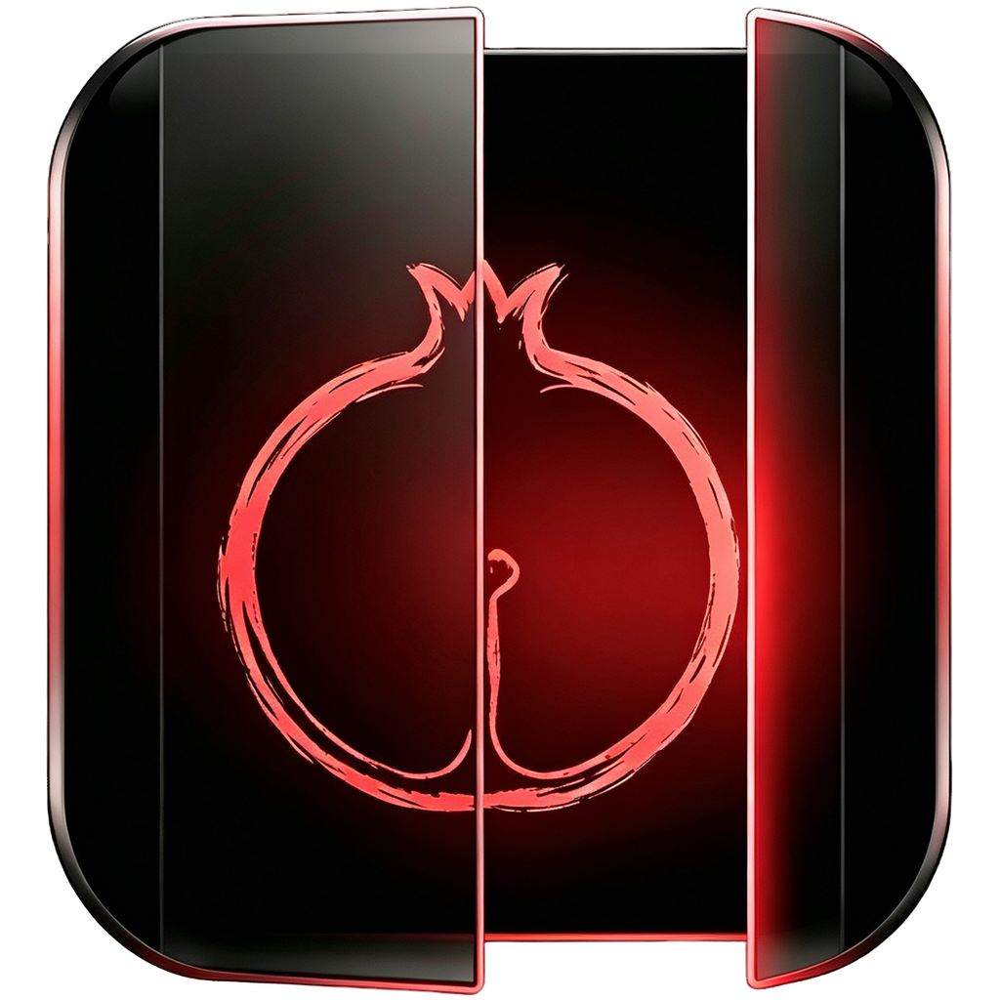
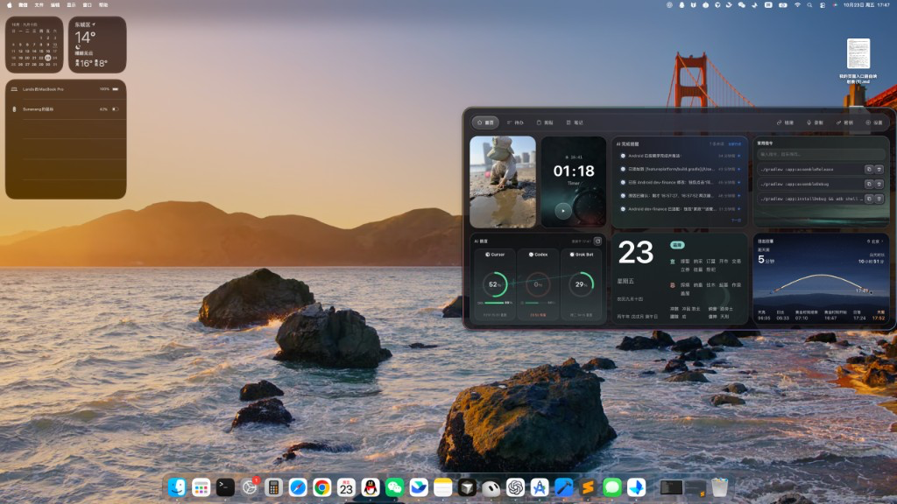
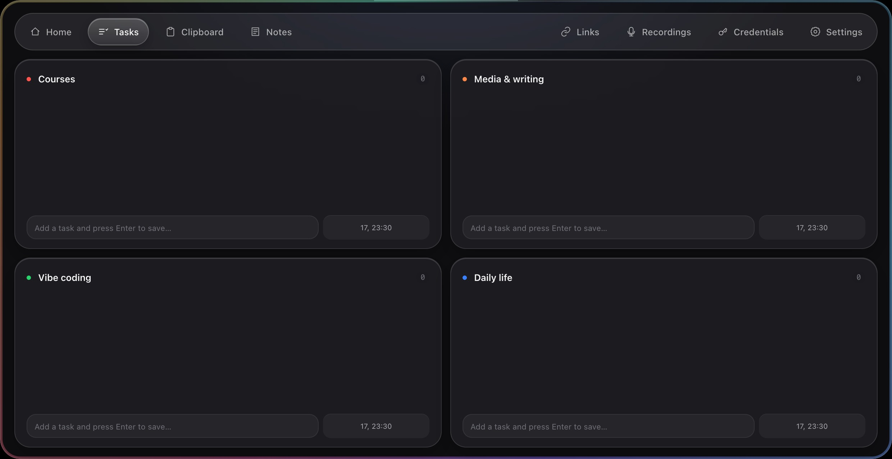
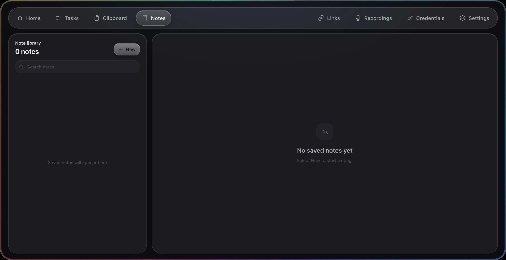

<div align="center">
  
  <h1>Pome Panel</h1>
  <p><strong>Your workspace, one click away.</strong></p>
  <p>Tasks, notes, links, recordings and AI alerts, ready at the edge of your screen.</p>
  <p>
    <a href="https://github.com/Sunanang/Pome-Panel/releases">Get the app</a> ·
    <a href="#get-started">Get started</a> ·
    <a href="docs/user-guide.en.md">User guide</a> ·
    <a href="https://github.com/Sunanang/Pome-Panel/issues">Report an issue</a>
  </p>
  <p>
    
    
    
  </p>
  <p>
    <a href="README.md">简体中文</a> ·
    <a href="README.zh-TW.md">繁體中文</a> ·
    <strong>English</strong> ·
    <a href="README.ja.md">日本語</a> ·
    <a href="README.ko.md">한국어</a> ·
    <a href="README.es.md">Español</a> ·
    <a href="README.fr.md">Français</a> ·
    <a href="README.de.md">Deutsch</a> ·
    <a href="README.ru.md">Русский</a> ·
    <a href="README.pt-BR.md">Português (Brasil)</a>
  </p>
</div>



<p align="center"><sub>Click the capsule to expand. Drag it while collapsed to dock on any screen edge. Arrange Home to suit your workflow.</sub></p>

## One panel for everyday work

| Feature | What it does |
| --- | --- |
| **Home workspace** | Arrange widgets for focus timers, quick notes, the almanac, sunrise and sunset |
| **Tasks and notes** | Organize 1–8 task categories with due reminders; write Markdown notes and keep a searchable library |
| **Links and recordings** | Save websites by group, record audio, and optionally enable live transcription and smart naming |
| **AI assistants** | Check remaining quotas across providers and receive task completion alerts from connected sources |
| **Clipboard and credentials** | Enable clipboard history when needed; encrypt accounts and keys with system secure storage |
| **NAS sync** | Optionally pair a fnOS NAS to sync workspace content across devices |

<details>
<summary><strong>See tasks and notes</strong></summary>
<br />
<table>
  <tr>
    <td width="50%"><p align="center">Plan your tasks</p></td>
    <td width="50%"><p align="center">Capture your notes</p></td>
  </tr>
</table>
</details>

## Get started

1. Check [Releases](https://github.com/Sunanang/Pome-Panel/releases) for installers: `arm64.dmg` for Mac or `windows-x64-setup.exe` for Windows.
2. Open the app and click the capsule at the screen edge. Drag it while collapsed to change its position.
3. Choose your features in Settings. AI connections, transcription and NAS sync are optional.

Installer availability follows Releases. If no installer is available, run from source. See the [changelog](CHANGELOG.en.md) for work in progress.

> Data stays in your local `Pome Panel` folder unless you choose another location. NAS sync is optional. Some Windows native features are off by default; see the [user guide](docs/user-guide.en.md#windows).

## Run from source

```bash
git clone --branch dev https://github.com/Sunanang/Pome-Panel.git
cd Pome-Panel
npm install
npm run setup:hooks
npm start
```

Use Node.js 18+. See [development docs](docs/development.en.md) for tests, the website, NAS companion and builds.

## Learn more

[User guide](docs/user-guide.en.md) · [Development](docs/development.en.md) · [Changelog](CHANGELOG.en.md) · [NAS companion](fnos/)

The interface supports English, Simplified Chinese, Traditional Chinese, Japanese, Korean, Spanish, French, German, Russian and Brazilian Portuguese. New translations await native-speaker review; screenshots and traditional almanac content retain their original language.

---

Based on [TO-DO-Panel](https://github.com/xiaopu-ai/TO-DO-Panel). Thanks to the original author for making it open source.

[MIT License](LICENSE) · [Sunanang](https://github.com/Sunanang)
