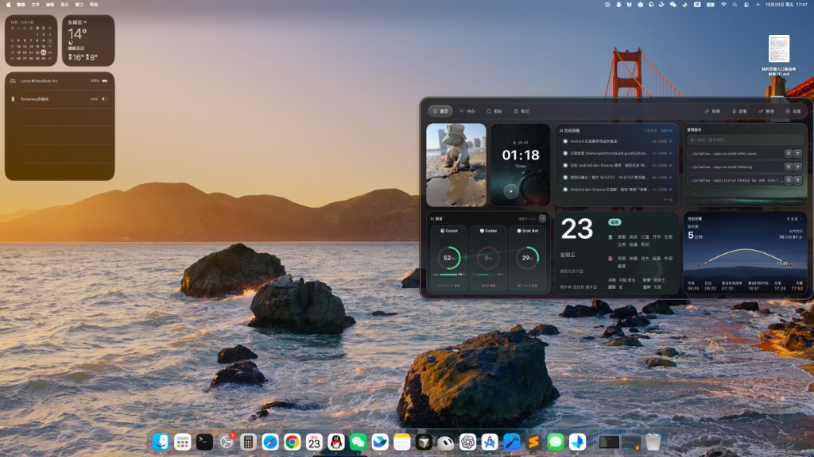

<div align="center">
  
  <h1>Pome Panel</h1>
  <p><strong>随手展开的桌面工作台。</strong></p>
  <p>待办、笔记、链接、录音与 AI 提醒，放在屏幕边缘，随时取用。</p>
  <p>
    <a href="https://github.com/Sunanang/Pome-Panel/releases">获取安装包</a> ·
    <a href="#开始使用">快速开始</a> ·
    <a href="docs/user-guide.md">使用指南</a> ·
    <a href="https://github.com/Sunanang/Pome-Panel/issues">反馈问题</a>
  </p>
  <p>
    
    
    
  </p>
  <p>
    <strong>简体中文</strong> ·
    <a href="README.zh-TW.md">繁體中文</a> ·
    <a href="README.en.md">English</a> ·
    <a href="README.ja.md">日本語</a> ·
    <a href="README.ko.md">한국어</a> ·
    <a href="README.es.md">Español</a> ·
    <a href="README.fr.md">Français</a> ·
    <a href="README.de.md">Deutsch</a> ·
    <a href="README.ru.md">Русский</a> ·
    <a href="README.pt-BR.md">Português (Brasil)</a>
  </p>
</div>



<p align="center"><sub>点击胶囊展开，收起后拖到屏幕四边；首页组件可以自由调整。</sub></p>

## 一个面板，处理日常小事

| 功能 | 能做什么 |
| --- | --- |
| **首页工作台** | 自定义组件与布局，集中查看专注计时、速记、黄历、日出日落与当前天气 |
| **待办与笔记** | 1–8 个待办分类、到期提醒，配合 Markdown 速记与笔记库 |
| **链接与录音** | 分类收藏网址，录制音频，可选实时转写与智能命名 |
| **AI 助手** | 查看多家 AI 剩余额度，接收已接入来源的任务完成提醒 |
| **剪贴板与密钥** | 按需开启剪贴板历史，用系统安全存储加密账号与密钥 |
| **NAS 多端同步** | 可选配对飞牛 NAS，在多台设备之间同步工作区内容 |

常用指令采用单行列表与备注胶囊：悬停无备注行点「＋」，或点已有胶囊编辑；回车/失焦保存、Esc 取消，清空即移除备注。6 字计数仅作提示，旧长备注保留全文。指令或胶囊被截断时，悬停约 450ms 可查看全文；迷你档隐藏胶囊和操作按钮，有备注时仍可悬停查看。复制只取指令正文，备注随工作区同步。AI 完成提醒持续显示本机监听状态，端口占用时提示异常并自动重试；可在「设置 → AI 工具」测试接入。Codex 接入遵循启动环境的 `CODEX_HOME`（默认 `~/.codex`），修改配置后需要完全退出并重新打开 Codex。Computer Use 包装导致的嵌套 Codex 接入会提示修复，清理旧 Pome 层并保留原通知链；Codex 再次改写后需重新修复。

额度凭据按需读取：每次启动后，在「设置 → AI」点击「读取额度 / 重试授权」才为本次运行启用本机登录及已保存 Token 的读取；主动保存 Token 只启用该来源。Codex 无需凭据的本地记录仍可读取。Token 与录音配置状态展示不提前解密，密钥库在打开页面时才读取；拒绝后的后台额度刷新不会反复请求，需主动重试。系统授权由 macOS 处理，Pome 不会获取 Mac 登录密码或遍历整个钥匙串。已启用的 NAS 自动同步、Manus 完成提醒仍会在启动时读取所需凭据；系统锁定、权限或签名变化可能继续触发提示。

「设置 → 常用」和菜单栏可切换会议模式：暂停顶部提示，完成事件与等待状态继续保存；退出后按原有提醒开关恢复，尚未展示的待办继续提醒。会议期间已保存的 AI 完成记录可在首页查看，不集中补弹旧完成气泡。应用目前不播放独立通知提示音。

macOS 与 Windows 均提供默认开启的「自动会议模式」：摄像头持续使用约 3 秒，或检测到投屏 / 屏幕共享、系统勿扰（专注）状态，任一条件满足即暂停顶部提示；全部条件连续解除约 30 秒后恢复。手动会议模式独立保留，自动检测不会将其关闭；自动状态不写入手动开关，也不参与 NAS 同步。设置页分别显示三类状态；共享检测覆盖系统镜像和受支持软件中可识别的共享控制，不能保证识别所有软件及网页共享。macOS 读取共享控制受辅助功能权限限制，专注状态受系统共享能力限制；Windows 勿扰检测采用 Shell 兼容查询，系统版本不支持时显示无法检测。无法读取不代表未触发：已触发的自动暂停会保留，可关闭自动模式解除。检测不采集画面或声音；本应用镜子使用的摄像头不作为外部使用的依据，同一设备无法区分其他使用者时显示无法检测。

常用指令、待办、笔记、链接、录制和密钥在删除前统一弹出确认，显示内容预览与数量；录音、链接分组和待办分类会说明一并删除的内容。取消或按 Esc 保留原内容。

首页随笔记始终作为可恢复的编辑草稿。点击「保存」后，内容收进笔记库并从首页清空；整个随笔记组件保留背景、标题、按钮和正文，先收窄成弯曲漏斗，再吸入顶栏「笔记」；原位恢复空白组件。动画期间可继续写下一条，减少动态效果时改为轻量反馈。笔记库点击正文即可编辑，点击「保存」或按 Ctrl/Cmd+S 回到预览，保持当前阅读位置；后台自动保存不退出编辑。链接点击和拖选正文保持原用途，保存失败保留内容并在错误栏提供重试。

工作台采用轻量分类与内容索引：待办显示未完成数量；笔记和录制采用左侧列表、右侧详情的分栏，密钥页左侧新增、右侧搜索与管理。录音播放器支持播放、进度、音量和速度控制。

待办在截止前一小时提醒；错过窗口且尚未展示的任务会补提醒。一次积压至少 3 条过期任务时合并成一条摘要，点击进入待办并高亮对应条目。提醒实际展示后才保存状态，关闭提醒、排队或退出不会消耗未展示项；重新开启或启动后恢复。同一任务与截止时间的已提醒标记保存在工作区 `todo-reminders.json` 并参与待办同步，旧同步值不会回退标记；修改截止时间后重新计算。两台设备同时离线时仍可能各自提醒，联网后合并状态。Windows 原生能力关闭时，点击气泡仍按平台规则仅关闭提醒，可从待办页查看。

macOS 的「当前窗口」按系统辅助功能暴露的标准窗口枚举与聚焦，保留真实同名窗口，不按系统图形表的序号切换。点击已关闭或无法聚焦的窗口会提示刷新，不自动改开另一个窗口；最小化窗口可恢复。窗口名为主、应用名为辅，窄组件使用可滚动单列，全部条目均可滚动访问。长按拖出可单独隐藏窗口，点击「恢复」找回；旧的隐藏偏好继续保留。此功能使用辅助功能权限，不再为读取窗口标题申请屏幕录制权限。

窗口发现覆盖所有显示器坐标，并补充其他桌面及全屏空间中被 AX 普通清单省略的窗口。跨桌面发现使用有时间上限的 macOS 兼容接口，较大的窗口清单可能随刷新逐步补全；接口不可用时回退到系统直接暴露的窗口。点击仍验证窗口身份和系统编号，已关闭的旧条目不会转向同名窗口。

macOS 安装版使用独立标识 `com.pomepanel.app`，可与旧 TO-DO Panel 并存。首次更新到此标识后，在「系统设置 → 隐私与安全性 → 辅助功能」为实际安装路径下的 Pome Panel 单独授权；旧应用的权限不会自动转移。资料目录仍为 `Pome Panel`。源码改动发布到 `dev` 后，需从该分支重新构建并替换安装版，仅拉取代码不会更新已经运行的应用。

## 开始使用

当前源码开发版本为 **0.11.0**。仓库尚无正式 Release 安装包，可按下方开发命令运行源码；正式安装包发布后将在 Releases 页面提供。

1. 在 [Releases](https://github.com/Sunanang/Pome-Panel/releases) 查看安装包：Mac 选择 `arm64.dmg`，Windows 选择 `windows-x64-setup.exe`。
2. 打开应用，点击屏幕边缘的胶囊展开；收起后可以拖动，调整停靠位置。
3. 在「设置」里选择需要的功能。AI 接入、录音转写和 NAS 同步均按需配置。

设置 → 外观可选择面板尺寸：标准 1240×638、适中 1040×580、紧凑 880×520（逻辑像素，屏幕不足时保留安全距）。档位仅保存在本机，重启恢复，与首页卡片尺寸无关；切换后仍沿保存的屏幕边缘停靠。

三档都会把剩余空间分配给当前可见卡片，铺满首页内容区；已经铺满的标准档布局保留原位置，旧布局空洞只在显示时补齐，不回写卡片尺寸或为填空扩张其它卡片的配置。编辑时保存/取消独立占行，底部错误提示出现时首页按剩余高度适配。常用指令添加备注后仍保留行间距，多条指令在卡片内滚动。AI 完成提醒的「全部已读」始终靠右，监听状态在其左侧；小卡片的监听状态另起一行。

首页按用户模块顺序和现有四档足迹依次显示，容量分别为 48 / 36 / 24；下一张放不下时，其后模块在当前档位暂不显示，原有顺序、大小和显隐偏好保留。容量提示及不可加入的模块只在「设置 → 显示 → 首页」呈现，首页不外滚、不常驻无空间条。新用户及重置布局优先显示日出日落、黄历，音乐和快速录音默认隐藏；已有用户布局继续保留。从右键菜单调整卡片大小或进入「编辑布局」换位。其它页面沿用分栏与区域内滚动。设置使用左侧「常用 / 外观 / 显示 / AI / 数据 / NAS」分组，右侧只展示当前组并可独立滚动。普通进入默认「常用」，首页与托盘等具体设置入口会定位对应组；旧锚点仍可跳转。AI 组保留八家来源；六家 Token 设置合在各自来源行内，默认收起，展开填写或获取并保存，录音转写与命名仍在同组。数据页将本地目录、导出和恢复分成三块，无需 NAS 也能备份；NAS 连接、同步详情与故障处理直接展开。温度单位与界面动态效果可独立选择。

原生窗口隐藏时会暂停天气与背景动效、停止镜子摄像头、暂停音频播放并收起密钥明文。重新显示后，镜子仍需主动点击开启；进行中的录音不会因隐藏面板而中断。

安装包以 Releases 实际发布为准；尚无安装包时可从源码运行。开发中的功能与修复见[更新日志](CHANGELOG.md)。

> 数据默认保存在本机 `Pome Panel` 文件夹，可自行更换；NAS 同步是可选功能。Windows 的部分原生能力默认关闭，详见[使用指南](docs/user-guide.md#windows-上的几件事)。

## 从源码运行

```bash
git clone --branch dev https://github.com/Sunanang/Pome-Panel.git
cd Pome-Panel
npm install
npm run setup:hooks
npm start
```

使用 Node.js 18+。测试、NAS 伴侣与构建说明见[开发文档](docs/development.md)。

## 更多说明

[使用指南](docs/user-guide.md) · [开发文档](docs/development.md) · [更新日志](CHANGELOG.md) · [NAS 伴侣](fnos/)

界面支持简体中文、繁體中文、English、日本語、한국어、Español、Français、Deutsch、Русский、Português (Brasil)。新增翻译仍在校对，截图与黄历传统内容保留原语言。

---

基于 [TO-DO-Panel](https://github.com/xiaopu-ai/TO-DO-Panel) 二次开发，感谢原作者的开源贡献。

[MIT License](LICENSE) · [Sunanang](https://github.com/Sunanang)

## 官网源码

官网位于 [`website/`](website/README.md)，独立安装依赖与构建，支持与桌面端一致的十种语言。运行和验收方法见该目录说明；源码纳入本仓库不代表网站已部署。
