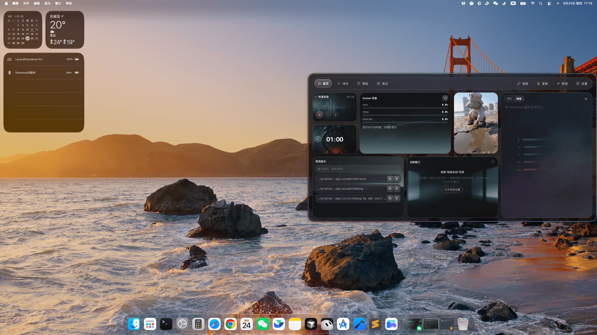
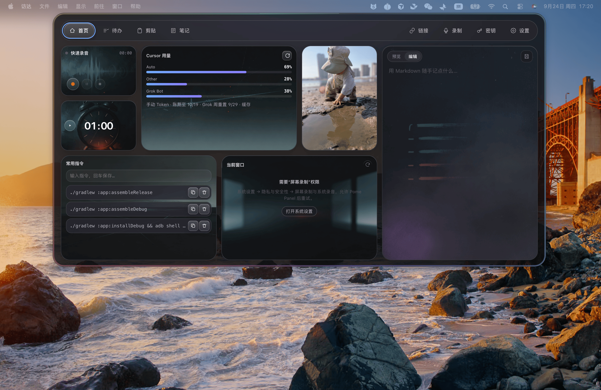

[简体中文](README.md) · [English](README.en.md)

<div align="center">
  
  <h1>Pome Panel</h1>
  <p><strong>Mac 与 Windows 上的桌面工作台。</strong></p>
  <p>一块半透明玻璃面板。首页是 Bento，同一处切换待办、笔记、链接、录制与密钥。macOS 上收起后可以拖到屏幕四边，展开时从你停下的位置长出来。</p>
  <p>基于 Todo Panel 二次开发。</p>
  <p>
    <a href="#和-todo-panel-的差别">和 Todo Panel 的差别</a>
    ·
    <a href="#从源码运行">从源码运行</a>
    ·
    <a href="https://github.com/Sunanang/Pome-Panel/issues">反馈问题</a>
  </p>
  <p>
    
    
    
    
  </p>
</div>



首页展开后是一块玻璃面板，可以停在桌面一侧。里面是快速录音、番茄钟、AI 剩余额度、照片、常用指令、当前窗口和 Markdown 速记。



同一块面板的近景。系统菜单栏留在它上方。待办、剪贴、笔记都在顶栏里切换，窗口大小不变。

## 界面与识别语言

桌面首次启动按系统语言选择简体中文或英文，其他语言回退英文。「设置 → 本机与唤出 → 语言」可选择跟随系统、简体中文或 English；偏好只保存在本机，不参与 NAS 同步，切换保留当前输入与用户原文。日期数字使用界面语言和系统地区格式。

「录音转写与命名」中的录音识别语言独立选择中文或英文，不随界面切换改变，录音中的重连也保持开始时的识别语言。智能命名按内容语言生成，历史标题、笔记、项目名、AI 摘要和自定义地名不自动翻译。

NAS 网页通过官方 SDK 读取当前宿主用户语言，兼容环境回退浏览器；可手动切换并在此浏览器保存偏好。NAS 安装、配置、升级、卸载向导及 Windows 安装/卸载仅提供中英，随系统语言；应用内手动选择不改变安装器语言。macOS 使用 DMG 与 Finder，系统权限用途说明提供中英，不另建卸载向导。

官网提供[中文](https://Sunanang.github.io/Pome-Panel/)与[英文](https://Sunanang.github.io/Pome-Panel/en/)页面；[英文指南](README.en.md)与[英文更新日志](CHANGELOG.en.md)覆盖面向用户的使用和历史发布说明，内部研发文档保留原文。

## 和 Todo Panel 的差别

Pome Panel 基于 Todo Panel 二次开发。仓库没有登记可核对的上游地址，下面只列这个仓库里的能力。

| | Pome Panel |
| --- | --- |
| **它是什么** | 桌面控制台：Bento 首页，加上待办、笔记、链接、录制、密钥。待办是其中一页 |
| **放在哪里** | **两端都可以改位置。** 收起成一颗短胶囊，拖动后吸附到屏幕的上、下、左、右。靠近某一端时，展开面板靠向那个角（例如右下角）；否则沿这条边居中。位置会记住。设置里可以「重置到顶部」 |
| **首页** | 快速录音、番茄钟、AI 剩余额度、常用指令、Markdown 速记、镜子。Mac 上还有汽水音乐和当前窗口。组件可以隐藏，也可以改布局。首页布局只留在本机 |
| **多设备** | 飞牛 NAS 伴侣（`fnos/` 里的 Pome Panel）。配对后，在多台设备之间同步待办、笔记、链接、常用指令、剪贴板、AI 完成记录、录音、AI 配置和密钥。密钥以加密盒传输 |
| **名字** | Pome Panel（石榴）。开发者 Lando |

## 面板怎么摆

折叠态是一颗短胶囊：贴在上下边时大约 85×9，贴在左右边时竖过来。点一下展开；按住拖动则搬家。松手时按指针离四边的远近吸附，坐标写进本机设置。沿这条边，离屏幕一端大约 120 逻辑像素以内时，展开面板会靠向那个角。没有自定义位置时，胶囊在顶部居中：macOS 上是菜单栏正下方，Windows 上是工作区顶部，都不会压住任务栏或菜单栏。

展开后各页内容区都是 `1240 × 540`。切换页面只换内容，不改窗口大小。窄屏和矮屏会留出边距。

菜单栏托盘可以重新显示面板、设置唤出快捷键、开机启动。默认唤出是悬停后按空格，也可以改成别的组合键。

## 里面有什么

| 页面 | 做什么 |
| --- | --- |
| **首页** | 上面的 Bento。至少保留一个组件；隐藏后其余格子重新铺满 |
| **待办** | 四个可改名的工作流（内部键仍是 P0–P3，默认「课程 / 自媒体&写作 / Vibe coding / 日常」）。新建默认当天 23:30，按截止时间排序，到期前一小时提醒 |
| **笔记** | 首页速记保存后进入笔记库，可搜索、重命名、编辑和删除 |
| **链接** | 只保存公开的 http/https。抓取标题时拒绝本机、内网和不安全重定向 |
| **录制** | 音频写在本机 `recordings/`。可选百炼 Qwen3-ASR 实时转写，API Key 经系统安全存储或环境变量读取 |
| **密钥** | 账号、密码和 API Key 使用系统安全存储，页面不能直接读出明文 |
| **设置** | 录音转写与命名、AI（完成接入与额度 Token）、显示（工作区与首页开关）、NAS 同步、镜子封面、默认展开页、唤出快捷键、面板位置、数据目录、开机启动 |

首页 Bento 的「AI 完成」模块可回看 Codex / Claude Code / Cursor 的完成事件及 NAS 同步历史（旧 GPT 历史保留，显示为“其他”）。模块支持四档尺寸：迷你显示未读数与最新来源，小号显示最近 3 条，中号显示最近 5 条，大号显示 10 条及项目摘要。记录按模块尺寸分页（迷你 1、小号 3、中号 5、大号 10 条），不再提供“查看全部”模式。第 1 页只显示“下一页”；后续页显示“上一页”和当前页码，仅在确实有下一页数据时显示“下一页”，总数不超过一页时隐藏分页区；迷你尺寸始终隐藏整个分页区。新完成记录到达时保留当前页，翻页后列表回到顶部，卡片尺寸保持不变；「全部已读」通过逐条保存标记已有记录。首页 tab 未选中时在文字右上方显示未读角标（超过 9 为 9+），损坏时显示 !；选中首页时隐藏。模块关闭时角标显示小点，点击转到首页模块设置；模块开启时点击返回首页并高亮。关闭 AI 完成后在原空位显示淡色“添加模块”入口；再开启会保留其他组件的尺寸和位置，重新开启时优先恢复原位置，空间不足只缩小 AI 完成本身。记录先落盘再提醒，点击记录时标已读；按接收时间保留最新 100 条，超出后自动清理最早记录（含未读），新增、启动载入和读取使用同一规则。去重使用来源的完成事件 ID，或来源、任务与完成时间/回合序号生成的稳定身份，延迟重试和重启重投不会再提醒；同一会话的新回合仍正常接收。去重信息随记录保留，数量淘汰时一起清理；已淘汰事件再次投递不保证去重。缺少明确身份的旧钩子事件仍接收，以补充的完成/接收时间和内容生成身份；没有原始 ID 的旧事件无法保证跨时间重投仍被识别为同一事件。收件箱损坏时显示“备份损坏文件并重建”，确认弹窗展示完整备份路径和可能无法恢复历史的影响；取消继续暂停，确认后先保存并校验原始字节，再原子建立空收件箱。收件箱在本机 userData 落盘，并通过 NAS 同步完成记录及已读状态；不参与普通资料备份。同步按来源与稳定完成身份合并，拉回历史不重弹通知；本机窗口和目录信息不跨设备。新增、载入和跨设备合并统一保留最新 100 条，NAS 同样裁剪并留下删除标记，防止离线旧记录复活。首次配对按已有的本机/NAS 为准流程处理；旧 NAS 伴侣需先升级以支持 AI 完成集合。点击记录直接打开来源软件，不定位聊天或会话：Codex 打开桌面版，Cursor 打开 Cursor，Claude Code 打开终端。macOS 优先复用 cwd 对应的 Terminal 标签页，找不到时新开终端并进入该目录；Windows 优先 Windows Terminal，回退 PowerShell。没有 cwd 时只打开终端；目录须为存在的绝对目录。未安装或打开失败时显示轻提示。

「设置 → NAS 同步」提供 `.pome-backup.zip` 本机资料备份，即使未配对也能导出实际待办、分类、笔记、链接、指令、剪贴板和录音媒体。v1 清单记录应用版本、集合条数及 SHA-256；恢复先校验并保存当前资料快照，替换失败会回滚。密钥、AI Key、配对、同步控制状态、首页布局和系统设置不进入普通备份，恢复保留当前凭据与设置。

已配对设备恢复后暂停同步，重启继续暂停。需要重新预览并确认本机覆盖 NAS 的新增、修改和删除影响；本机或 NAS 变化使预览过期。NAS 必须先保存并读回验证快照，覆盖按服务器版本原子提交，核验成功后恢复同步；不支持快照的旧伴侣禁止覆盖。本轮没有“先拉取再合并”的执行入口。最近覆盖可在 NAS 没有后续变更时回退快照，回退产生新版本并保持同步暂停。

同步结果按内容类型显示，录音元数据与音频分开；超过 6 MiB 或缺失的音频不会显示为已传输。本机备份仍保存完整超限音频；本机音频不完整且 NAS 已有完整音频时禁止破坏性覆盖。笔记冲突以新的笔记 ID 保留版本，按来源及版本去重，标题不会递归生成“副本的副本”；待办维持服务器实际接受的版本顺序，不做字段级自动合并。密钥新增与编辑默认使用密码掩码。

剪贴板历史默认关闭，可从菜单栏或「设置 → 显示 → 工作区」打开。它只在本机轮询，不占用全局快捷键。Windows 上没打开原生能力时，点击条目是复制，再用 Ctrl+V 粘贴。

剪贴板普通历史按复制时间保留最新 100 条，超过后自动清理最早记录；收藏永久保留，不占用这 100 条名额（仍可手动删除或清空）。本地新增、启动载入、资料恢复与 NAS 同步投影使用同一裁剪规则；取消收藏后重新计入普通历史，超限的旧记录立即淘汰。NAS 合并后被淘汰的普通记录会同步删除，避免再次拉回；清理图片时保留仍被收藏或其他记录引用的文件。

Windows 上「汽水音乐」永久隐藏；「当前窗口」与剪贴板自动粘贴需要在「设置 → Windows 原生能力 · 实验功能」里手动打开（见 [Windows 上的几件事](#windows-上的几件事)）。关闭状态下不会改写已经保存的显隐偏好，换回 macOS 时组件还在。

飞牛同步在设置页右侧的「NAS 同步」卡里填写地址和一次性配对码，卡片位于封面图片与本机设置之间。「高级」可配置一个备用外网地址；状态行显示整体同步时间，「详情」逐项显示各类内容的结果和各自同步时间。同步暂停时，恢复预览与快照回退入口直接显示在卡内。设备令牌放在系统安全存储，不写入 LocalStorage。本机工作区仍是数据落点；明文 HTTP 默认关闭，回环地址除外。

飞牛伴侣将同步数据、设备配对、账号同步密钥和请求去重记录保存在数据目录的 `sync-state.bin` 检查点及 `sync-state.bin.transactions/` 增量事务目录，服务重启后继续使用原状态。每次写入只持久化变动，累计 256 个事务再安全合并检查点，旧录音不会随普通修改反复写入；校验、顺序或存储损坏时停止启动并保留原文件。NAS 内部检查点 v3 自动读取并升级旧 v1/v2 数据，旧伴侣不能读取 v3，不可直接降级。备份伴侣数据时必须一并保留检查点、事务目录与 `server-id`；普通桌面 ZIP 备份仍为 v1。清理按原子检查点完成：所有未撤销配对设备已确认的日志前缀可截断；未确认日志默认保留 90 天，超期游标明确要求全量重同步。幂等结果默认保留 90 天，清理后拒绝旧基线请求，客户端拉取并重建待发送请求；远端删除不能被旧队列复活。快照保护最近一次已提交覆盖、30 天回退窗口内的覆盖，以及 24 小时有效期内正在暂存的操作；其他快照默认达到 90 天后清理。准备操作超出 24 小时需要重新预览；回退仍需校验 NAS 没有后续变更。可通过 `FNOS_SYNC_RETENTION_DAYS` 与 `FNOS_ROLLBACK_WINDOW_DAYS` 设置正数天数；处理请求时每小时或累计 256 个事务触发检查。其他实际内容及删除标记不按这些缓存规则清空；剪贴板和AI 完成记录另按各自的数量规则保留。

更换本机数据文件夹时，空目录用于迁移当前工作区；已有 `workspace.json` 的目录会提示打开其中的数据，当前工作区先保存到原目录。复制密钥密码时会标记为敏感内容，并从本应用剪贴板历史采集中排除。

Cursor 用量默认自动读取本机 Cursor 登录态。「设置 → AI 剩余额度 → Cursor」中的「获取本机 Token」可一键读取已登录的本机 Cursor（macOS 与 Windows 均支持），填入密码输入框后再点击「保存」。无需安装 sqlite3 或 Python。保存的 Token 优先用于查询用量，本机以系统安全存储加密，并随 NAS 的 AI 配置以加密盒同步到其他已配对设备；失效时回退本机登录态。点击「清除」会恢复本机登录模式，并同步清除其他设备保存的 Token。未保存的输入不会同步。

首页「AI 额度」只显示已检测到或配置 Token 的来源（catalog：Cursor、Codex、Claude、Grok Bot、Grok、Copilot、Antigravity、Manus）。采用 B 仪表盘马赛克，同屏显示来源，不再切换 Tab。默认展示该 AI 统计周期最短的额度窗口（如 Codex 的 5 小时额度优先于周额度）；周期相同时保留来源顺序，未提供周期时使用来源主统计，主窗口缺失读数时保持未知，悬停或点击展开各窗口细条；余额、积分及无限额度保留原单位，不伪造百分比。迷你最多显示 4 个来源，5 家起显示 3 个来源 +「+N」；小号最多显示最紧急的 4 家，使用等宽 2×2，3 家时空出第 4 格；更多来源在额度顶栏刷新按钮左侧显示灰色「+N」入口。迷你/小号按失效、用完、告急、偏低、过期、正常排序，同级按瓶颈剩余排序；中/大号按设置来源顺序。中/大号 3–4 家同排、5–6 家使用 3×2，超过 6 家时在组件内滚动；不显示接入或摘要占位格。小号和中号只显示非主窗口进度条，单窗口来源不重复画条；大号保留实际窗口条，Grok Bot 的真实周条与同行第一条对齐。所有非迷你格子依次为单行名字与图标、居中环、窗口条及仅含真实时间的底部说明；不显示角标气泡或预留角标行。常规格子的环在名称下方、窗口条上方的剩余空间居中；无条格在名称与底部说明之间居中，无隐藏行占位。中号 3–4 家单排长条格的环位于整格垂直中线，窗口条跟随在圆环下方 10px。同卡环径与格子大小一致：小号 38px，中号 3/4/5–6 家为 72/60/32px，大号为 140/120/80px；实机空间不足时全卡统一缩小。常规布局先给名称、条与脚注留位，再将环在余下区域居中；中号单排长条布局将圆环居中、条随环排布，脚注仍在底部对齐。每家 AI 的窗口条按本家最长标题独立计算标题列，数值列按真实字体下的「100%」宽度固定，数字从列左侧起排；标题/轨道/可见数值间距为 3px/2px；整行按实际可见内容居中，固定数值列中未用到的预留宽度不计入视觉居中，数值位数变化时复用原动画平滑调整整组位置。不同 AI 不强求等长，同一家所有轨道左右对齐，动画中宽度保持不变。窗口详情、数据来源、重置时间与更新时间可通过悬停或点击查看，多窗口超出时在明细内滚动。Grok Bot 是 Cursor Sand 会话池独立卡（使用本机登录或已保存 Cursor Token），与 xAI 的 Grok 分卡展示。都未检测到时显示连接说明与设置入口。首页布局沿用原 `cursor` 模块 ID。额度统一显示「59%」，额度条越满表示剩余越多；剩余 ≤20% 为橙色、≤10% 为红色。缺失数据保持 `--%`；Grok 的预付账本余额直接显示美元，不生成百分比条。Manus 通过官方 v2 接口显示可消费积分余额，不用余额与月度配额推导百分比。

额度窗口名称统一使用「日额度」「周额度」「月额度」「N 小时额度」「N 天额度」；紧凑视图可缩写为日、周、月、5h。Codex 与 Claude 的相同周期采用相同名称，不重复显示「7 天 · 周额度」；Grok Bot 标为周额度；Cursor 标为月额度，并保留 Cursor / Other 分类（非迷你窗口条统一缩写 Cur / Oth；接口字段仍为 auto / other），重置说明不再使用账期或账单措辞。Copilot 按实际池显示高级请求额度、聊天额度、补全额度，Antigravity 保留模型名并在已知时标注周期；Grok 保留已入账预付余额、Manus 保留可用积分，不推测缺失的周期。

Codex 配置手动 access token 后，由主进程向 `https://chatgpt.com/backend-api/wham/usage` 查询实时额度，超时 10 秒；沿用首页的定期刷新与刷新按钮。未配置 Token 或联网失败时，回退读取本机 `$CODEX_HOME/sessions/YYYY/MM/DD/rollout-*.jsonl` 的最近 `token_count` 记录，默认目录为 `~/.codex`；Windows 还会检查 `%USERPROFILE%\.codex`。两种来源按实际 windowMinutes 展示额度周期、套餐、Credits 与更新时间；仅有周窗口时只显示周额度，额外模型额度按各自名称和周期列出，标签分别为「手动 Token」和「本机 Codex」。重置时间按本地日期显示为「HH:MM 重置」「明天 HH:MM 重置」或「M/D HH:MM 重置」。过期记录的圆环和额度条半透明，并提示「数据过期」；Token 失效显示红色虚线和重新获取提示，网络故障仍保留可用的旧数据。网络故障且没有可用本机记录时保留上次成功的远程数据与原更新时间。各家额度重置时间与 Cursor 的账期结束时间统一按本机时区显示到分钟；Cursor 账期仅有日期时保留日期，缺失时保持未知，底层时间戳保留原精度。Cursor 也保留同一账号的最近成功值并标注刷新失败；退出、切换账号或认证失效时不复用旧账号缓存。可选的 Grok Bot 用量失败不会阻断 Cursor 主额度。刷新按可见性降频，并在已知额度重置后主动更新；展示首页额度面板时先显示缓存并后台查询，30 秒内重复唤出复用缓存，手动刷新仍立即查询。成功变更时环长与数字按 720ms ease-out 同步过渡，窗口细条错开 60ms；中途新结果从当前帧继续，首次从 0 开始，相同值或失败不播放新动画。减少动态效果时直接切换；用完的变灰和划线在过渡结束时切换。

「设置 → AI」按统一列表管理各家完成接入与额度，每个来源的 Token 控件直接放在该行下方。Cursor / Codex 保留获取本机、保存与清除操作；Grok Bot 注明依赖 Cursor 登录；Claude 用量走本机 OAuth；Copilot / Grok / Antigravity / Manus 可配置手动 Token（`safeStorage`），Grok 还需 xAI 团队 ID；只接受 Management API Key，显示以美元计的已入账预付余额，不伪造订阅额度百分比。Manus 使用官方 `https://api.manus.ai/v2/usage.availableCredits` 与 `x-manus-api-key`，只以 `data.total_credits` 作为可消费积分余额。Codex「获取并保存」仅在主动点击时读取本机 `auth.json`，并通过系统安全存储保存；默认收起手动输入框。Token 不写入工作区、不进日志、不自动续期。401/403 标记失效并可回退本机记录；网络故障不会把有效 Token 标失效。完成 HTTP 接收 Codex / Claude / Cursor / Grok / Copilot CLI / Antigravity。Manus 完成不走 HTTP：在设置里单独开启「接收完成提醒」后，由本机用已配置的 API Key 只读轮询官方任务 API（面板运行时检查，关闭后下次启动补查）；点击打开 manus.im 任务页。等待输入/授权尚未接入。

首页编辑模式下拖动卡片只交换位置，各自保留尺寸；靠近网格边界时向左或向上收，有冲突则按原尺寸顺序重排。补洞锁定交换双方，只允许其他卡片扩展；无法按原尺寸放下时提示「空间不够，无法交换」并保留原布局。

## 简化交互

- 只有全新安装会进入三步欢迎：学习唤出、选择首页组件、可选连接 NAS 或 AI。欢迎向导从当前平台默认布局开始，按用户勾选逐项设置组件；升级不改变已有布局。设置 → 显示 → 首页仅提供各组件的独立显隐开关，加入组件时保留原有自动让位规则，至少保留一个组件，录音中不可隐藏快录。
- NAS 卡默认只显示连接状态、一句说明和主操作。地址、配对、迁移、回退、HTTP 和备份放在「故障处理」；暂时连不上时提供重试。省略协议时补 HTTPS；检测到 HTTPS 指向纯 HTTP 服务时仅纠正输入地址，再次操作仍需明文确认，不自动降级传送凭据。
- Cursor/Codex 的「获取并保存」由主动点击触发，只读本机登录并加密保存。其余手动 Token 收在「手动填写」，Grok 团队 ID 与 Manus 完成开关保留。状态只按实际成功的额度数据说明生效来源。
- AI 额度默认每家显示最短统计周期的剩余值，悬停、点击或键盘可展开窗口明细；迷你脚注显示瓶颈窗口及紧急状态摘要，可点击或按 Enter/空格查看完整详情，非迷你卡片的来源名保持单行，空间不足时优先使用 Claude / Antigrav 等短名，再按可用宽度缩字号或省略，悬停与无障碍标签保留完整名；环长和大数字使用最短窗口，颜色、紧急排序与过期判断使用所有窗口的最小剩余瓶颈；长周期偏低时由窗口条等级色和真实重置时间提示，未知时间不显示。用完时灰环、淡红底轨和数字划线，mini 用色点与单行摘要提示；小号/中号不重复主窗口条，大号保留实际窗口条，明细显示所有窗口并独立标色。失效显示居中红色虚线圈与叹号，底部仅留「失效 · 去设置」；迷你失效摘要直接打开设置。过期沿用原阈值，头部显示灰色时钟与真实数据年龄，环、数字与窗口条降至约 45% 透明度。Grok Bot 来自代码中的 Cursor Sand 接口，可使用本机登录或已保存 Cursor Token，不是 xAI Grok 余额。
- 随笔记保留预览、编辑和保存操作，保存后可从顶栏「笔记」进入资料库；快录提供「在录音中打开」。关闭工作区会隐藏对应顶栏 tab；关闭录音工作区也会隐藏快录入口。前三次唤出会提示胶囊操作。
- 覆盖确认先显示来源及增改删摘要，详情可展开；取消不写入。凭据读取、保存或清除失败统一显示可关闭的报错条，提供修复入口与复制脱敏诊断；报错条单独占位，内容区可滚动，避免遮挡底部控件；本机登录缺失或读取失败与登录过期分别提示。必填项等表单校验保留行内提示，摄像头以及布局空间不足等瞬时提示短暂显示；布局应用并保存成功后清除对应布局报错，取消、无变化或保存失败时保留。Windows 的「当前窗口」可内联开启原生能力，加载失败时保留可恢复提示；仍不绕过强制关闭开关。

## 设计原则

- **停在边上，展开才占一块桌面**：macOS 收起只留一颗胶囊，展开从你选的边长出来。窗口边界变更不使用系统动画，视觉动效留在渲染层，并尊重「减少动态效果」。
- **设备按需启用**：镜子只有主动点击才开摄像头，离开首页或收起时立刻释放。麦克风只在开始录音后使用，结束录音或退出应用时释放。
- **数据留在这台电脑**：待办、笔记、链接、录音元数据和工作区设置写在本地。可以更换数据文件夹，把工作区拷到另一台电脑。系统加密过的密钥不保证跨电脑迁移。
- **同步是附加项**：飞牛伴侣同步待办、笔记、链接、常用指令、剪贴板、AI 完成记录、录音、AI 配置和密钥。它不替换本机存储。首页布局不同步。
- **权限边界清晰**：链接抓取拒绝本机、内网和不安全重定向。窗口聚焦只接受最近一次扫描缓存里的窗口 ID。剪贴板跳过密码管理器标记为敏感的内容。

## 本机 AI 完成提醒

Pome Panel 只在 `127.0.0.1:43821` 监听通知，来源限 `codex`、`claude` 与 `cursor`，其余一律 404。提醒是一块不抢焦点的小窗。子代理结束和云端会话不会弹出。Windows 上点击提醒即关闭。

带倒计时的通知气泡在鼠标悬停时暂停，移开后从原剩余时间继续，不额外补时；即使已经接近消失，也不会把进度条重新拉长。

```bash
curl -X POST http://127.0.0.1:43821/notify/codex \
  -H 'Content-Type: application/json' \
  -d '{"title":"任务已完成","project":"my-project","task_id":"demo","event_id":"demo-completion-1"}'
```

在「设置 → AI」检测并接入可 hook 的完成来源（Codex、Claude Code、Cursor、Grok、Copilot CLI、Antigravity）；同一列表展示其余家的额度能力与归属说明。Grok 写入 `$GROK_HOME/hooks/pome-panel.json`（未设置时为 `~/.grok/hooks/pome-panel.json`）的 Stop / StopFailure；按会话与 `promptId` 区分轮次和重试，忽略子代理及退出会话事件。Grok 来源名与图标在完成气泡和收件箱中保留，点击沿用终端打开方式；完成历史参与 NAS 同步及统一的最新 100 条裁剪。确认浮层列出修改文件、Pome 钩子内容和同目录的 `.pome-backup-时间戳` 备份；确认后先校验备份再原子写入。配置损坏时拒绝修改，预览过期或文件被外部编辑后需要重新确认。仅增删 Pome 标记项，其他配置、钩子和缩进保留；Codex 的原 `notify` 被继续转发，断开后还原。Codex 接入后需重启工具。

通知与收件箱保留 completed / failed / awaiting / due 状态。标题跳过空泛的“已完成”首行，摘要最多保留 4096 字符，省略只发生在显示层，悬停可读完整摘要。Codex 原生会话名按精确 thread ID 只读本机会话索引或 SQLite 元数据，与完成摘要分开保存；不存在时不伪造。打开来源软件失败时保留气泡、暂停倒计时并显示原因，可重试或点 × 关闭。

优先用 Pome 自带 Electron 的 Node 运行时，脚本采用当前应用安装路径。每次启动检查接入路径，应用搬家后可点「修复」。Claude Code 使用 `hooks.Stop`，Cursor 使用官方 `hooks.json` v1 的 `hooks.stop` 与 `hooks.afterAgentResponse`，以 conversation_id 与 generation_id 关联摘要并去重。现有 stop-only 配置仍可接收通知；在设置中点「修复」可补上摘要钩子。原生 error 映射为失败，aborted 不作为成功提醒。摘要仅在本机私有目录缓存（读取有效期 10 分钟、最多 256 条、每条 4096 字符；后续写入清理过期项），stop 读取后移除；可用时也会有界读取 transcript_path。首次检测到未接入工具会提示；「以后再说」仅存本机并停止重复提示。

设置和首页不再显示「发送测试」。后端测试接口仍经过同一转发脚本和本机接收服务，不产生历史、未读或真实完成提醒。首页未接入、等待第一条、接入失效三个空状态分别引导接入、管理、修复。损坏收件箱仍使用独立的确认重建流程。

仓库提供 [Codex](scripts/codex-notify.js)、[Claude Code](scripts/claude-notify.js)、[Cursor](scripts/cursor-notify.js)、[Grok](scripts/grok-notify.js)、[Copilot CLI](scripts/copilot-notify.js)、[Antigravity](scripts/antigravity-notify.js) 转发脚本。Claude 云端会话（`CLAUDE_CODE_REMOTE=true`）不会转发；Grok 触发的 Claude/Cursor 共用钩子由 Grok 脚本接管。

Copilot CLI 使用 `$COPILOT_HOME/hooks/pome-panel.json`（默认 `~/.copilot/hooks/pome-panel.json`）的 `agentStop` 与不可恢复的模型/系统错误事件；退出会话、子代理及可恢复的工具错误不作为完成。按当前助手结果标识去重，缺少结果时使用带时间的事件身份。配置使用直接执行参数，避免 shell 转义。

Antigravity 使用 `~/.gemini/config/hooks.json` 中独立的 `pome-panel.Stop`，保留其他 hook；仅在后台任务全部结束且停止原因为模型结束时提示完成，系统错误或步数耗尽提示失败。会话与执行序号区分轮次。官方事件未提供回答正文，完成摘要暂使用默认标题；App/IDE 打开 Antigravity，CLI 打开终端。两家均保留“受限”标记，未声称覆盖 Copilot VS Code/云端或未验证的转录格式。其他 Stop hook 若要求继续运行，首版仍受门控事件时序限制。Grok Bot 完成接入保持未支持。Manus 完成见上文 API 轮询通道（partial）。

Manus 监听按账号保存分页检查点与待核验的结束事件；同账号更新 Key、断网和正常重启保留进度，主动关闭后再开启从新监听时段开始。新任务、活跃任务和旧任务分页扫描共用限流预算并公平调度，大量任务或长时间离线会增加发现延迟，不保证实时或任意离线时长完全补齐。完成记录与其他来源合计保留最新 100 条并同步 NAS；内部仅保留必要的去重控制信息，已确认投递的正文会从控制队列清除。标题、摘要和同步字段在落盘前过滤敏感凭据。Key 本身具有较广权限，面板仅调用读取接口，不替用户回答、授权或修改任务。

### AI 待操作提醒（开发版）

**范围**：完成提醒可接入 Codex / Claude / Cursor / Grok / Copilot CLI / Antigravity。额度按各家已接入的数据来源展示。等待输入/选择/授权目前主要覆盖 Claude（受限）；Codex、Cursor、Grok、Copilot CLI 与 Antigravity 尚未启用等待监听，不会用猜测或轮询冒充等待状态。

新的 v2 事件在同一回环接收地址上区分完成与等待输入、选择、授权。macOS 等待气泡采用 B 蓝色定稿（400×146，顶部 32px 黑区），Windows 为 384×114 顶部卡片。完成气泡保持原尺寸。等待摘要单行显示；敏感参数在落盘前隐藏，完整安全摘要在首页「AI 完成 → 待处理」列表查看。来源图标与状态独立。

等待没有倒计时；单条常驻，有竞争时按 8 秒时隙与完成通知公平轮换。气泡 `+N` 统计当前展示项以外仍会再出现的条目（其他可见等待 + 完成队列），已隐藏的等待不计。悬停暂停，完成计时继续原剩余时间。点击主体/按钮仅返回来源，× 只隐藏这次提醒，均不算已回答。来源的匹配解决、取消或继续事件撤销请求，不额外弹已回答。首页 AI 完成组件的「待处理 · N」入口在首页打开小列表，可返回来源、重新弹出隐藏提醒；重启后未确认的请求仍可返回来源核实。存储损坏时，同一入口提供备份并修复操作。首页组件被隐藏时，可先从「设置 → 显示 → 首页」恢复 AI 完成组件。Windows 原生能力关闭时提示「请返回来源软件」，点击仅隐藏，不加载 koffi。

等待状态只保存于本机 userData 下的 `ai-attention.json`，不进入完成历史、LocalStorage 或 NAS。身份包含来源、客户端 surface、会话、回合、请求；乱序解决事件留短期 tombstone。重启/断开后保留入口并标为需确认，不自动重弹或按超时宣布完成。存储损坏/外部修改会拒收，可从首页待处理入口确认后先备份原文件再重建。

Claude 的一键接入/修复会预览并追加专用观察 hook（PreToolUse、PostToolUse、PostToolUseFailure、Notification、UserPromptSubmit、Stop、SessionEnd），stdout 为空，不回答、不授权。旧 Stop-only 接入提示「等待提醒需补全」。AskUserQuestion 关联精确 tool-use ID；`idle_prompt` 不提醒；没有稳定请求 ID 的授权/表单仅在明确的继续或结束边界收敛，不用无关工具返回猜解决。授权 Notification 可能约 6 秒后触发。授权请求优先使用来源的请求/通知身份，否则每次 hook 调用生成独立观察 ID；同一观察在当前回合内的网络重投合并，新调用（包括同命令再次请求）分别记录。缺少原生 ID 时无法可靠区分来源重复触发与新请求，因此仍为 partial。批量撤销一次原子提交，隐藏请求不计入气泡 +N；固定 npm install 脱敏预览支持中英文前缀，完整命令和参数不会转发。当前缺少 Claude Code 实机验收，能力为 partial；Codex 桌面端与 Cursor IDE 的等待事件未验证，未启用 watcher/bridge，不承诺覆盖现有弹框。详情见 [事件方案](docs/plans/2026-10-18-ai-notification-events.md) 和 [实施与验收记录](docs/plans/2026-10-18-ai-attention-implementation.md)。

Codex 完成输出中，整条文本（可含一层 JSON 围栏）恰为 `{"suggestions":[]}` 或 `{"exclude":[]}` 时忽略；普通 JSON 与含 JSON 的自然语言结果保留。旧同形记录只在分页、总数、未读和最新条目的统一投影中隐藏，不批量删除。旧 notify 无已核实的用户意图证据，因此用户刻意要求输出该精确空数组对象时也可能命中此窄规则；未经验证的 `final:true` 不绕过过滤。

## Windows 上的几件事

全新安装首次打开首页时，日出日落默认显示，可用组件会重新排布并填满首页网格；未改动的旧 Windows 默认布局也会自动修复。Mac 默认布局与用户自定义的组件显隐、尺寸和位置不变。两端的城市选择气泡会避开面板边界，搜索列表较长时在气泡内滚动，自定义位置表单保持可操作；收起面板后立即关闭，下次展开需手动点击位置按钮重新打开。

### 安装目录与桌面快捷方式

双击 `windows-x64-setup.exe` 进入安装向导，在「选择安装位置」中填写目录或点击「浏览」选择，例如 `D:\Apps\Pome Panel`。安装完成后，桌面和开始菜单会创建指向该目录主程序的 `Pome Panel` 快捷方式；手动重新安装会恢复缺失的桌面快捷方式。程序文件保存在所选目录，默认目录为 `%LOCALAPPDATA%\Programs\Pome Panel`。

### 通知钩子怎么配

优先使用设置页的一键接入，不依赖 PATH 中的 Node。默认应用目录为 `%LOCALAPPDATA%\Programs\Pome Panel`，接入器使用实际安装路径。本机配置分别位于 `%USERPROFILE%\.codex\config.toml`、`%USERPROFILE%\.claude\settings.json` 和 `%USERPROFILE%\.cursor\hooks.json`。Windows 通过随应用分发的 PowerShell 文件桥接设置 `ELECTRON_RUN_AS_NODE=1`，把通知 JSON 当数据传给脚本；不会把 JSON 拼进命令表达式。只有用户确认后才写工具配置。仍需 Windows 真机验证，不以 Mac 回归代替。

### 原生能力（实验功能，默认关闭）

「当前窗口」、剪贴板自动粘贴和「点击完成通知聚焦对应窗口」在 Windows 上依赖进程内的 Win32 调用。这三项默认关闭，在「设置 → Windows 原生能力 · 实验功能」里打开后立即生效，不需要重启。

打开后：首页出现「当前窗口」，列出当前虚拟桌面上的窗口（按前后顺序，排除工具窗口），点击即切换并还原最小化的窗口；点击剪贴条目会自动粘贴回刚才的窗口，只发送一次 Ctrl+V，不安装全局键盘钩子。目标窗口以管理员身份运行时，系统会静默拦掉模拟按键，所以面板会提前识别并提示手动粘贴；目标已关闭或中途被切走，则退化为「已复制」。

之所以默认关闭：安装包不签名，而「模拟按键」「枚举并切换其他进程的窗口」是安全软件的常见启发式特征。Windows Defender、火绒与 360 的首轮测试都无告警后，才会改成默认开启。排障时可以用环境变量 `POME_DISABLE_WIN_NATIVE=1` 启动，强制不加载原生模块。

### 第一次打开时的 SmartScreen

安装包没有代码签名，Windows 会弹出「Windows 已保护你的电脑」。点**更多信息 → 仍要运行**即可。安装包每次发新版都会重新触发这一步。安全软件报「未知发布者」或「新增开机启动项」时，同样是未签名导致的，可以在各自的信任列表里放行。

### 已知限制

- **不签名**：见上面的 SmartScreen 流程。
- **不跟随虚拟桌面**：切到别的虚拟桌面后面板不会跟过去，切回来即可。
- **没有汽水音乐**：控制汽水音乐依赖 macOS 的脚本接口，Windows 上这个组件永久隐藏。
- **原生能力默认关闭**：「当前窗口」、自动粘贴与通知点击聚焦要手动打开，见上面一节。
- **Windows arm64 未测试**：只发 x64 安装包。arm64 设备会在仿真下运行，随包的原生模块也是 x64 的，没有验证过。
- **胶囊只有 9px 高**：贴在工作区顶部，会盖住最大化浏览器标签栏最上面的一小条。任务栏放在屏幕顶部时胶囊落在任务栏下方；Win11 把窗口拖到屏幕顶部中央弹出的 Snap 布局条也会和它重叠。
- **剪贴板只复制**：没开原生能力时，点击条目是写回系统剪贴板，需要自己按 Ctrl+V 粘贴。

## 从源码运行

桌面端要求 Node.js 18 及以上：

```bash
git clone https://github.com/Sunanang/Pome-Panel.git
cd Pome-Panel
git switch dev
npm install
npm run setup:hooks
npm test
npm start
```

没有渲染层构建步骤。`npm start` 就是完整的桌面运行路径。

`dev` 是长期开发分支，开发、修复、测试和版本准备都在此完成。`main` 只用于发布，禁止直接开发或提交修改，只接收 `dev → main` 的 PR 合并。合并后 GitHub Actions 自动测试并构建 Mac、Windows 和 NAS 安装包；正式 Release 继续通过 `main` 上与版本一致的 `v*.*.*` 标签发布。合并后将 `main` 同步回 `dev`，后续继续在 `dev` 开发。

每次新克隆后执行 `npm run setup:hooks` 启用本地保护：拒绝在 `main` 提交，拒绝直接推送、强推或删除远程 `main`（包括 `dev:main`）。安装脚本将 hook 存放在 Git 公共目录中，因此切换分支后保护仍生效。`dev` 推送和版本标签不受此保护限制。本地 hook 不替代 GitHub 远端分支保护。

| 命令 | 用途 |
| --- | --- |
| `npm test` | 语言资源检查、单元测试、Electron 集成测试与 JavaScript 语法检查 |
| `npm run i18n:generate` / `npm run i18n:check` | 生成 / 校验桌面、NAS、安装器与官网语言资源 |
| `npm start` | 启动 Electron 开发版 |
| `npm run pack` | 生成本地未打包目录 |
| `npm run build` | 在 macOS 上构建 Apple Silicon 产物 |
| `npm run build:win` | 在 Windows 上构建 x64 产物 |
| `npm run build:zip` | 构建 ZIP 产物 |
| `node scripts/build-fpk.js` | 使用已安装的官方 fnpack，在临时目录构建 NAS 通用 FPK 与 SHA-256，输出到 `dist.noindex/` |

GitHub Actions 的「Release macOS, Windows and NAS」会在推送 `main` / `feat/**`、提交 PR 或手动运行时测试并构建 DMG、Windows EXE 和 NAS FPK，产物可从该次运行的 Artifacts 下载。只有推送与桌面端及两份 NAS manifest 版本一致的 `v*.*.*` 标签，且三个构建任务都成功，才会把三种安装包及校验文件发布到同一个 Release。NAS 使用固定版本、校验 SHA-256 的[官方 fnpack](https://developer.fnnas.com/docs/cli/fnpack/)，无需连接 NAS 或提供设备凭据；真实 NAS 安装验证仍需另做。`scripts/pack-fpk.sh` 保持仅刷新协议副本和图标，不生成安装包。

官网在 `website/`，要求 Node.js 22.13.0 及以上，技术栈是 React 19 与 Vinext：

```bash
cd website
npm install
npm run dev
```

检查官网时使用 `npm run lint` 与 `npm run build`。

## 项目结构

```text
.
├── main.js                  # Electron 主进程：窗口、定位、菜单栏、剪贴板、媒体与通知
├── main-services.js         # 可单测的纯领域服务
├── preload.js               # contextBridge 安全桥
├── renderer/                # 桌面界面与交互
├── packages/sync-protocol/  # 桌面端与飞牛伴侣共用的同步协议
├── fnos/                    # 飞牛 NAS 伴侣 Pome Panel
├── scripts/                 # Codex / Claude Code 通知转发
├── tests/                   # Node 单元测试
├── build/                   # 图标与打包资源
├── docs/                    # 设计说明与 ADR
└── website/                 # React 19 + Vinext 官网
```

## License

[MIT](LICENSE) © 2026 [Sunanang](https://github.com/Sunanang)

工作中枢回归可运行 `npm run check:work-hub`：隔离夹具固定为 250 条笔记、200 条待办、100 个链接、20 条录音及 50 条完成记录，测量普通唤出与隔离 NAS 同步负载各 20 次。环境、原始耗时、P95、几何与同步结果留在 `dist.noindex/iteration-validation/<run-id>/`，不提交生成文件；Windows 真机和实体显示器/DPI 检查需要单独执行。
