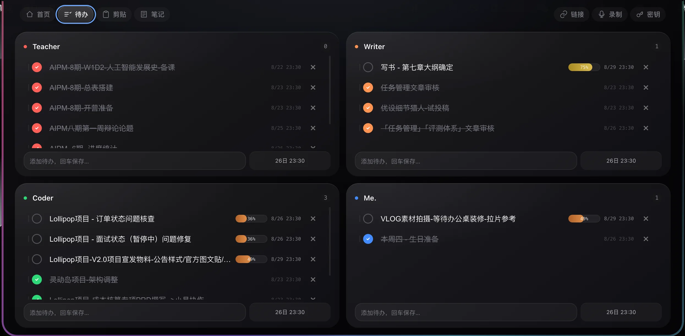
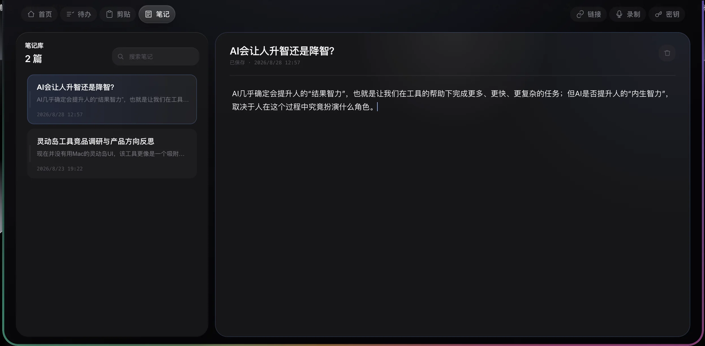

<div align="center">
  
  <h1>Pome Panel</h1>
  <p><strong>随手展开的桌面工作台。</strong></p>
  <p>待办、笔记、链接、录音与 AI 提醒，放在屏幕边缘，随时取用。</p>
  <p>
    <a href="https://github.com/Sunanang/Pome-Panel/releases">获取安装包</a> ·
    <a href="#开始使用">快速开始</a> ·
    <a href="docs/user-guide.md">使用指南</a> ·
    <a href="https://github.com/Sunanang/Pome-Panel/issues">反馈问题</a>
  </p>
  <p>
    
    
    
  </p>
  <p>
    <strong>简体中文</strong> ·
    <a href="README.zh-TW.md">繁體中文</a> ·
    <a href="README.en.md">English</a> ·
    <a href="README.ja.md">日本語</a> ·
    <a href="README.ko.md">한국어</a> ·
    <a href="README.es.md">Español</a> ·
    <a href="README.fr.md">Français</a> ·
    <a href="README.de.md">Deutsch</a> ·
    <a href="README.ru.md">Русский</a> ·
    <a href="README.pt-BR.md">Português (Brasil)</a>
  </p>
</div>


<p align="center"><sub>点击胶囊展开，收起后拖到屏幕四边；首页组件可以自由调整。</sub></p>

## 一个面板，处理日常小事

| 功能 | 能做什么 |
| --- | --- |
| **首页工作台** | 自定义组件与布局，集中查看专注计时、速记、黄历、日出日落等信息 |
| **待办与笔记** | 1–8 个待办分类、到期提醒，配合 Markdown 速记与笔记库 |
| **链接与录音** | 分类收藏网址，录制音频，可选实时转写与智能命名 |
| **AI 助手** | 查看多家 AI 剩余额度，接收已接入来源的任务完成提醒 |
| **剪贴板与密钥** | 按需开启剪贴板历史，用系统安全存储加密账号与密钥 |
| **NAS 多端同步** | 可选配对飞牛 NAS，在多台设备之间同步工作区内容 |

<details>
<summary><strong>看看待办和笔记界面</strong></summary>
<br />
<table>
  <tr>
    <td width="50%"><p align="center">分类安排待办</p></td>
    <td width="50%"><p align="center">记录和整理笔记</p></td>
  </tr>
</table>
</details>

## 开始使用

1. 在 [Releases](https://github.com/Sunanang/Pome-Panel/releases) 查看安装包：Mac 选择 `arm64.dmg`，Windows 选择 `windows-x64-setup.exe`。
2. 打开应用，点击屏幕边缘的胶囊展开；收起后可以拖动，调整停靠位置。
3. 在「设置」里选择需要的功能。AI 接入、录音转写和 NAS 同步均按需配置。

安装包以 Releases 实际发布为准；尚无安装包时可从源码运行。开发中的功能与修复见[更新日志](CHANGELOG.md)。

> 数据默认保存在本机 `Pome Panel` 文件夹，可自行更换；NAS 同步是可选功能。Windows 的部分原生能力默认关闭，详见[使用指南](docs/user-guide.md#windows-上的几件事)。

## 从源码运行

```bash
git clone --branch dev https://github.com/Sunanang/Pome-Panel.git
cd Pome-Panel
npm install
npm run setup:hooks
npm start
```

使用 Node.js 18+。测试、官网开发、NAS 伴侣与构建说明见[开发文档](docs/development.md)。

## 更多说明

[使用指南](docs/user-guide.md) · [开发文档](docs/development.md) · [更新日志](CHANGELOG.md) · [NAS 伴侣](fnos/)

界面支持简体中文、繁體中文、English、日本語、한국어、Español、Français、Deutsch、Русский、Português (Brasil)。新增翻译仍在校对，截图与黄历传统内容保留原语言。

---

基于 [TO-DO-Panel](https://github.com/xiaopu-ai/TO-DO-Panel) 二次开发，感谢原作者的开源贡献。

[MIT License](LICENSE) · [Sunanang](https://github.com/Sunanang)
