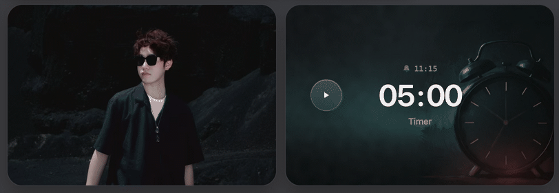
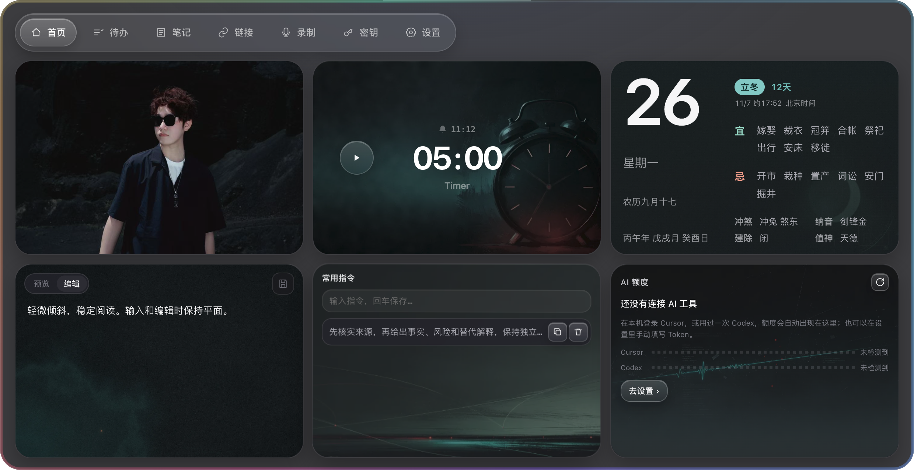
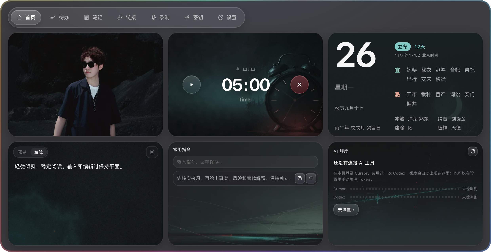
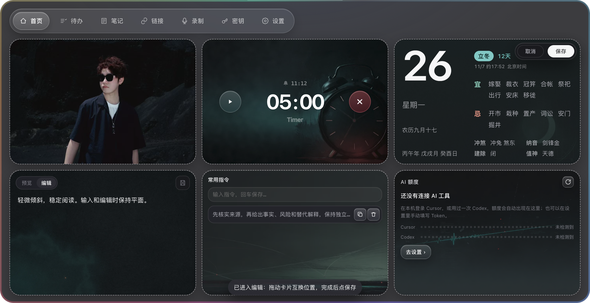

# 卡片轻微 3D 悬浮验收

日期：2026-10-26。基于当前 dev 工作区，保留前两轮悬停提示和拖拽修改。

## 当前参数

| 卡片 | 每轴角度上限 |
| --- | --- |
| 默认卡片、番茄钟、AI 额度 | ±2° |
| 镜子、音乐 | ±2.5° |
| 笔记、常用指令、当前窗口、收件箱 | ±1° |
| 黄历、日出日落、录音 | ±1.5° |

上浮 1–1.5px，180ms 过渡，随指针方向轻微调整阴影，不增加缩放或翻面。所有角度和视觉参数集中在 CSS 自定义属性中。

指针移动按帧合并；使用静止时的卡片矩形计算位置，避免倾斜后反复测量自身边界导致抖动。只在支持悬停的桌面环境中显示，触摸不触发倾斜。

移过按钮、链接等可点击内容时倾斜保持连续，避免中途弹回平面造成卡顿；指针按下或输入聚焦时立即恢复平面。镜子整卡封面可悬浮，但悬浮不会开启摄像头。鼠标离开平滑归位；失焦、尺寸变化、切页、收起、布局变化和进入布局编辑会清理待绘制帧与倾斜状态。系统减弱动态效果时关闭倾斜。

## 实际渲染记录

动图来自隔离 Electron 实际渲染的 60 帧截图。演示文件重复播放鼠标操作过程，应用自身没有空闲循环动画。GIF 有颜色压缩，清晰度以 PNG 截图为准。

1. 静止：首页直接显示，卡片保持平面。

2. 镜子封面：每轴不超过 ±2.5°，不启动摄像头。

3. 番茄钟：每轴不超过 ±2°，不增加缩放。

4. 常用指令：每轴不超过 ±1°，完整原文提示保持不变。

5. 输入聚焦：立即恢复平面，焦点保留在笔记输入框。

6. 鼠标离开：归位后保持稳定，无残留倾斜。

7. 减弱动态效果：无倾斜。

8. 编辑布局：倾斜关闭，原有拖拽交互继续正常工作。

## 检查结果与边界

- 80 项相关 Node 单测通过：domain、platform。
- 新增 `tests/home-card-hover.electron.js`，已纳入 npm test：检查实际 3D 矩阵、各轴角度边界、不缩放、300 次指针事件合帧、移过控件时倾斜连续、按下/聚焦后回平面、输入稳定、清理与减弱动态效果；悬浮不改写布局或常用指令数据。
- 现有 `home-layout-swap.electron.js` 通过：跨行列/异尺寸交换、预览缓存、平滑退回、实际落点、保存/取消和生命周期。
- 现有 `sun-home.electron.js` 通过：macOS/Windows 能力模拟、首页默认布局、设置弹层与收起。
- 现有 `almanac-home.electron.js` 通过：四种尺寸、布局边界、文字比例与无悬停说明气泡。
- JavaScript 语法、本地化资源与 git diff --check 通过。

实际运行平台为 macOS Electron，全部使用临时用户目录。Windows 只做能力模拟，未做 Windows 真机验收。没有打包、发布、提交或推送，没有操作真实摄像头、麦克风或 NAS 数据。
