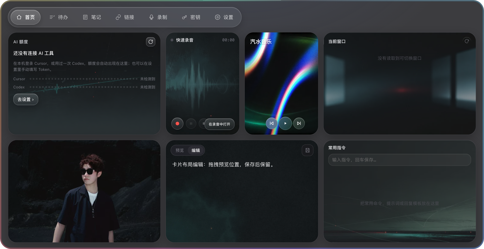
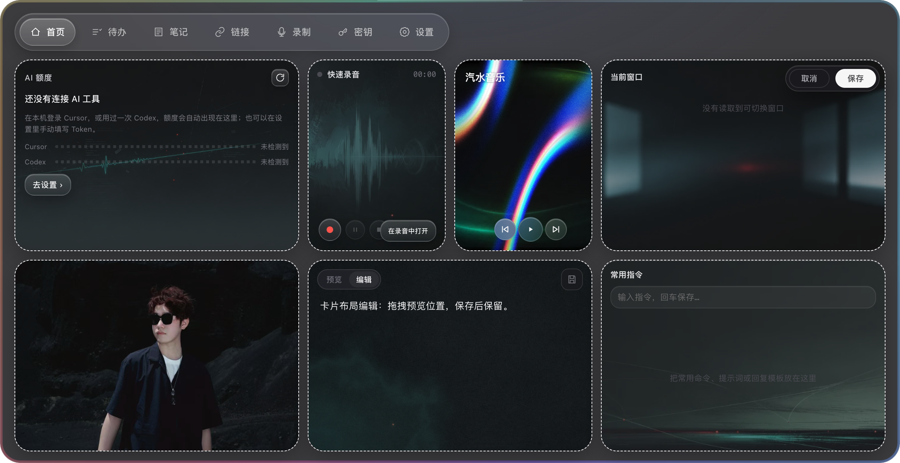
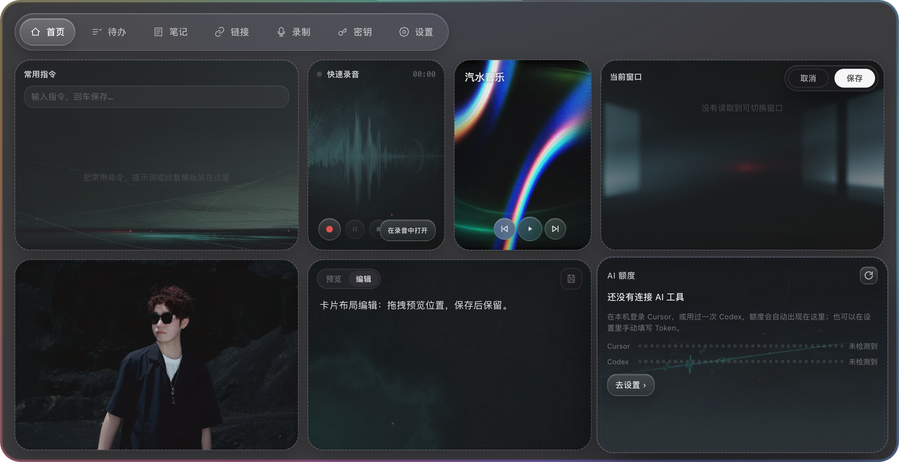
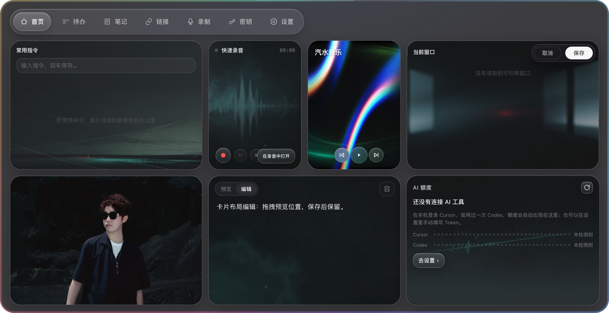
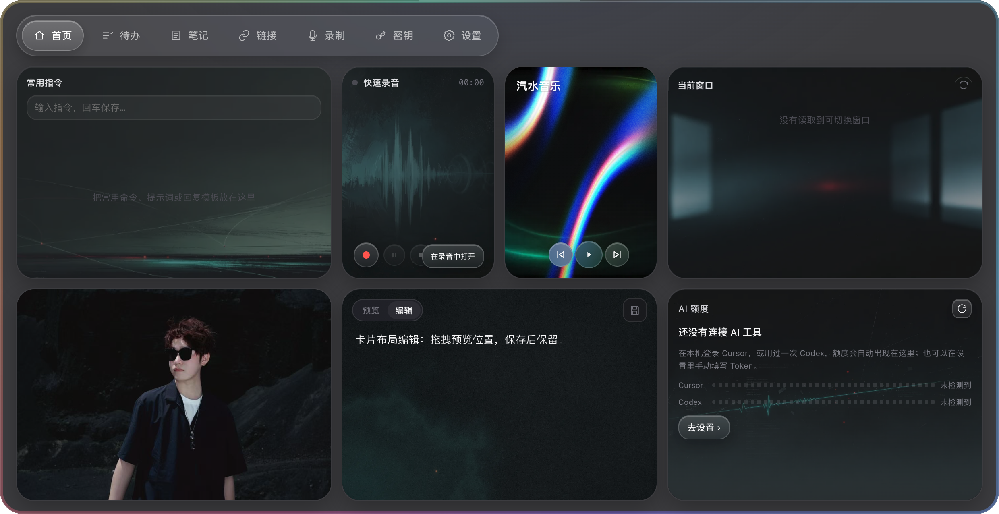

# 首页动效评估与拖拽验收

日期：2026-10-26。基线：`dev`，`75a7523` 加当前未提交修改。

## 范围与设计判断

本次审查的是桌面首页的展开、编辑布局、跨行拖动、落格与保存。使用 Electron 临时用户目录，截图来自本轮实际渲染。保留原有卡片风格、尺寸和保存/取消流程。

- 数据唤醒：不建议每次展开时隐藏卡片再依次显示，也不建议让已缓存的读数从零开始。这会推迟阅读，并容易将装饰动画误解为加载状态。如果后续尝试，只建议在首次启动时使用一次轻过渡，让内容保持可用，后续数据更新从上一个真实值过渡。本轮未添加。
- 模块拖拽：已有整卡拖动与换位，本轮优化编辑时的跟手、连续让位、落格和取消。
- 3D 悬浮：±8° 的整卡倾斜对密集文字、输入框和按钮偏重，这是基于当前画面的风格判断。现有指针光晕已经提供层次。本轮保留平面阅读；所提供的描述只定义了倾斜，没有定义真正翻面后的内容。

## 实现

- 指针移动通过 requestAnimationFrame 合并，每帧最多绘制一次，使用最新坐标；没有使用会让卡片等待指针停止的超时防抖。
- 每次拖动只测量一次网格几何，按目标缓存让位方案，复用落点占位元素。
- 让位与退回采用 220ms 平移过渡；拖动卡片均匀放大到 1.025。
- 松手从当前位置以 260ms 短促弹性过渡落格，动画结束后清理状态，无循环。
- 松手位置即使早于待绘制帧，也会作为最终目标；取消、窗口失焦、离开页面和收起会清理待绘制帧。
- 系统减弱动态效果开启时，不播放落格动画、不放大拖动卡片，位置仍随指针更新。
- 排序仍需显式保存，取消恢复编辑前状态；保留现有尺寸与网格打包规则。

## 截图步骤

1. 展开首页：正常，内容可读，没有新增逐卡入场或零值计数。

2. 进入编辑：正常，保留虚线边界和保存/取消控件。

3. 跨行拖动：正常，AI 额度卡片从左上拖向右下，常用指令卡片让到原位置；落点保持原卡片占地。

4. 松手：正常，短促吸附后保持稳定，没有残留拖动样式或占位元素。静态截图不能单独证明帧率，结束状态另由 Electron 动画与几何断言检查。

5. 保存及重新加载：正常，编辑边界关闭，位置保持；隔离验收脚本也检查了重新加载后的持久化布局。

## 检查结果

- 87 项相关 Node 测试通过：domain、platform、almanac。
- `home-layout-swap.electron.js`：同尺寸/异尺寸、跨行列、无空间失败、按帧合并、预览缓存、退回过渡、实际松手目标、待绘制帧取消、减弱动态效果、保存/取消及镜子资源生命周期通过。
- `sun-home.electron.js`：macOS 与 Windows 能力模拟下的首页默认值、保存布局、展开收起生命周期通过。
- `almanac-home.electron.js`：四种尺寸、文字比例、日期和取消气泡回归通过。
- JavaScript 语法、本地化资源校验和 git diff --check 通过。

同一脚本、相同七卡片布局，在一帧前同步发送 300 次交替目标移动事件：修改前进行了 150 次让位方案计算，修改后在下一帧进行了 1 次。这是合成事件压力夹具，不代表真实鼠标事件分布或真实帧率；后续跨帧反复访问目标的缓存也由回归测试检查。

## 验证边界

使用 macOS 上的 Electron 和临时用户目录；Windows 只做能力模拟，未做 Windows 真机或触摸屏验收。未进行完整键盘拖拽或读屏器审计，不能据此宣称完整无障碍合规。没有更改真实工作区、NAS 数据或账号配置，没有提交、推送、打包或发布。
