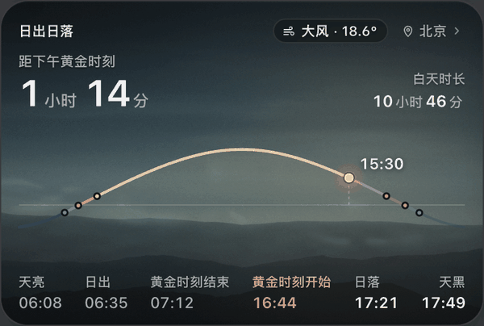
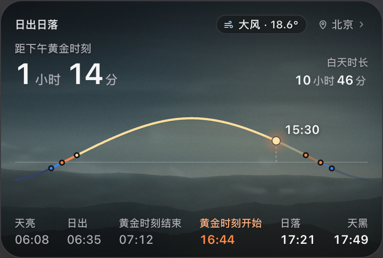
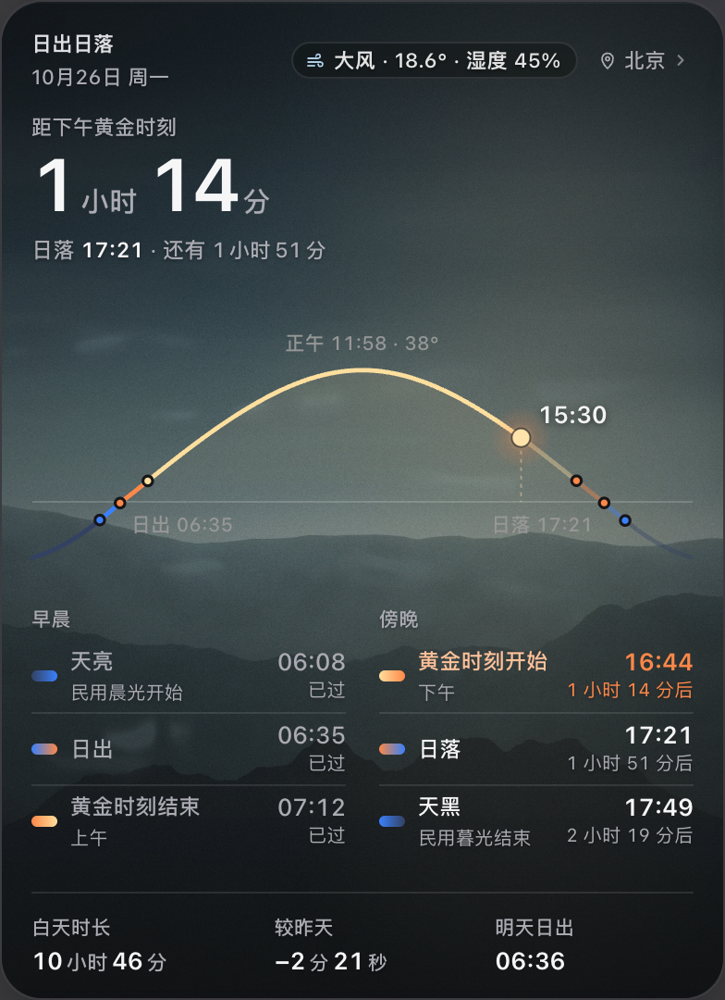
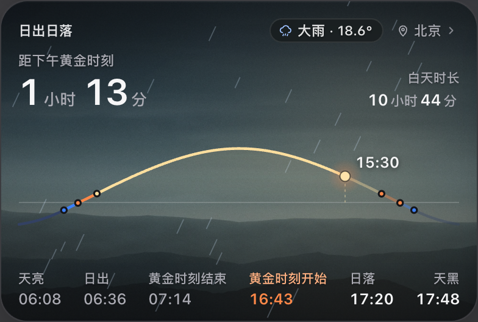

# 日出日落风效：模糊、分散、同向随机漂移

日期：2026-10-26。以用户最后补充的“飘渺、模糊、分散；大方向一致、每缕不同”为准。

## 最终表现

- 去掉可辨认的卷曲符号、闭环和清楚的轮廓。
- 用带透明断层、软边和不均匀密度的细长气流纹理，避免整块匀速平移。
- 保持从左向右的共同大方向；每缕气流具有独立速度、阵风相位、平滑随机偏转、长度、宽度、出现和消散位置。
- 随机值驱动连续插值轨迹，没有逐帧随机抖动；纹理方向沿当前运动切线微调。
- 普通风更少更轻，强风更密，雨风组合降低气流亮度并保留雨的原有斜向运动。
- 仍然只在中、大尺寸且页面可见时运行；天气动效开关、减弱动态效果、切页和收起清理规则保持生效。

最初参考了[用户提供的 GIF](https://pic.rmb.bdstatic.com/bjh/news/4ef278de1b61fffafc679e8e5f1290bb.gif)的气流变化，但最终没有采用树、落叶、清晰弯钩或固定卷曲路径。

## 实际渲染证据

动图由隔离 Electron 的 60 帧实际卡片截图生成，GIF 会重复播放这段录制；运行中的气流则在离开卡片后重新随机生成。GIF 有颜色压缩，静态清晰度以 PNG 为准。

中尺寸强风：

大尺寸强风：

普通风：

雨风组合：

## 验证

- 28 项相关 Node 测试通过（sun-weather、sun）。
- 检查 30/60/120 Hz 每次飞行的位置一致性、共同风向、轨迹差异和连续性、透明纹理边缘、低透明度、纹理缓存、离屏重生，以及雨的运动保持不变。
- 完整 sun-weather Electron 验收通过：四种尺寸、十种语言、天气缓存、唤醒刷新、设置开关、图层、所有天气动效、减弱动态效果、切页/收起暂停、隐藏与资源清理。
- JavaScript 语法与 git diff --check 通过。

测试使用临时数据目录和模拟天气。未更改真实天气数据、账号配置或 NAS 数据；Windows 真机未验证。没有提交、推送或打包。视觉风格仍以用户查看实际动图后的判断为准。
