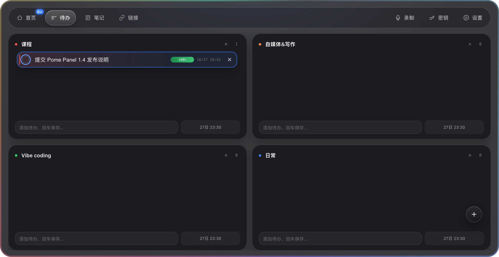

# 待办到期提醒与点击定位

日期：2026-10-27。`dev` 工作区，隔离临时用户目录。

## 规则

- 到期前 1 小时顶部气泡 1 次
- 若截止后仍未提醒过，启动/调度时补弹 1 次「已过期」
- 同一截止时间最多 1 次；已收到到期前提醒时不再补弹过期提醒，改 DDL 后重置
- 同时至少 3 条过期待办合并摘要，点击后高亮对应条目
- 只在实际展示后消费提醒；未展示项在重新开启或重启后恢复
- 点击气泡：展开面板 → 待办 Tab → 高亮对应条目

## 截图

## 检查

- `tests/main-services.test.js`、`tests/notification-domain.test.js` 通过
- `tests/notification.electron.js` 通过（含点击打开与 overdue 气泡）

## 2026-10-28 全局复查修复

- 顶部气泡关闭时不再静默写入 `remindedAt`；重新打开开关会立刻补调度
- 入队前先判断开关，避免 suppressed 污染去重表后被当成 duplicate 消费
- `schedule-reminders` 合并内存中的 `remindedAt`，防止 IPC 回写前的竞态重弹
- 剪贴板 / 待办打开：先展开再切 Tab，避免被默认启动页盖掉
- 点击定位增加短重试，降低展开动画未完成时找不到行的概率

后续持久化、同步、摘要和真实错误修复验收见 [2026-10-28 可靠性记录](../2026-10-28-todo-reliability/README.md)。
