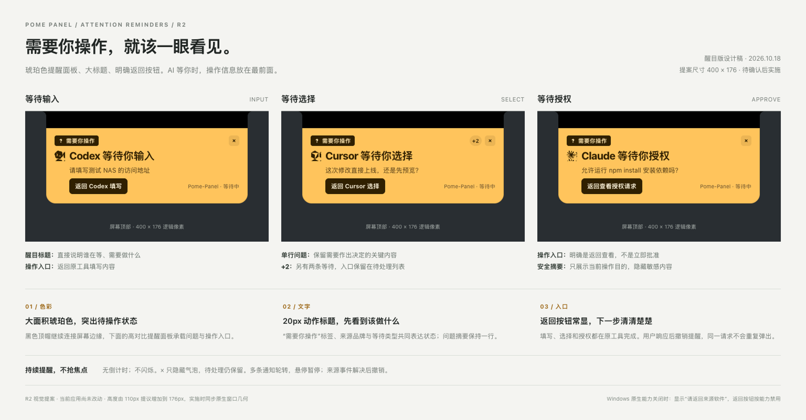

# 等待输入、选择与授权提醒设计

日期：2026-10-18。状态：设计稿，配套[技术实施方案](../../plans/2026-10-18-ai-notification-events.md)。问题和项目名均为示例，实际来源事件支持以实施验收为准。

## 查看

当前为 R2 醒目版：根据「需要用户操作的提示要特别明显」反馈，使用大面积琥珀色、20px 标题和常显返回按钮，保留黑色顶部连接区。提案尺寸为 400 × 176；应用本身未修改。



- [R2 交互预览](attention-v2.html)
- [R2 等待输入](input-v2.png)、[R2 等待选择](select-v2.png)、[R2 等待授权](approve-v2.png)

初版黑色轻提示保留供比较：

- [等待输入](input.png)：Codex 等待你输入；摘要说明需要补充的信息。
- [等待选择](select.png)：Cursor 等待你选择；摘要说明问题，`+2` 表示另有两条等待。
- [等待授权](approve.png)：Claude 等待你授权；展示安全的操作摘要。
- [交互预览](preview.html)：可试点气泡主体和 ×。这里只演示行为，不打开来源应用或代为作答。

## 视觉与交互

复用 `renderer/notification.css` 和仓库内已有来源图标、awaiting 与关闭符号。R2 的 macOS 气泡按 400 × 176 逻辑像素绘制，保留 32px 黑色顶帽；正文为高对比琥珀色，显示「需要你操作」标签、20px 动作标题和黑色返回按钮，不新增外部阴影。初版 400 × 110 的黑色轻提示已保留。

依次显示「需要你操作」、动作标题、单行问题摘要、返回按钮与项目状态。标题的来源名称可替换为任何已接通的工具，不将三种操作固定绑定到三个品牌。问题过长时截断，全文通过待处理入口查看；敏感输入只显示通用说明。

单条等待持续保留，不显示倒计时。收到对应的解决事件后撤销，不额外弹出“已回答”。点击主体返回来源软件；点击 × 只隐藏这次气泡，待处理请求仍保留。

多条等待与普通完成按时隙轮转，悬停暂停切换。角标统计额外待处理请求；点击来源不代表问题已解决。Windows 原生能力关闭时文案改为“请返回来源软件”，遵守当前点击能力限制。

## 重现设计图

在仓库根目录执行：

```sh
env -u ELECTRON_RUN_AS_NODE ./node_modules/.bin/electron docs/design/ai-attention-reminders/render.cjs

# R2 醒目版
env -u ELECTRON_RUN_AS_NODE ./node_modules/.bin/electron docs/design/ai-attention-reminders/render.cjs --revision=2
```

渲染脚本以独立临时数据目录加载本地设计页，不加载产品 `main.js`。导出总览与三张局部 PNG，R2 文件带 `-v2` 后缀；校验无倒计时、对应版本尺寸、返回提示、关闭与恢复演示。此校验只针对设计预览，不代表真实 AI 工具已接入。
