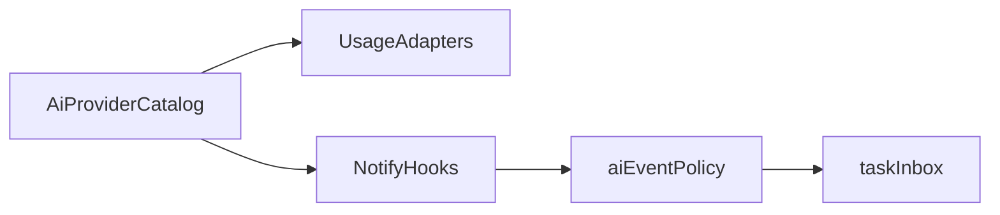

# 七家 AI：额度与完成统一接入

日期：2026-10-19。基线：`dev` / `e6eeda8`。状态：已合入 P0–P3（能力位以 `aiProviderCatalog.js` 为准；未验证完成通道仍不开放 HTTP）。

## 已定决策

- **1C**：`grok`（xAI 独立）与 `grokbot`（Cursor/Anysphere 会话池）各一张卡；设置写清归属，避免与 Cursor 主额度重复解读。
- **2C**：一次成型统一注册表 + 能力矩阵；额度与完成可不同步；只合入已验证能力，其余标 unsupported/partial。

稳定来源 ID：`codex`、`claude`、`cursor`、`grok`、`grokbot`、`antigravity`、`copilot`、`manus`。

## 原则

参考 [CodexBar](https://github.com/steipete/CodexBar)、[QuotaBar](https://github.com/gentpan/QuotaBar)、[Pulse](https://github.com/qunqin24/Pulse)、[aiusg](https://github.com/abnegate/aiusg) 几乎只做额度。Pome 完成通道是本机 `127.0.0.1:43821/notify/<source>` + hook。

- 额度：借鉴端点与本机凭据发现，在 Node/Electron 内重写（safeStorage、host 白名单、超时、不写回第三方 CLI 凭据）；不嵌入 Swift/Rust，不依赖另装菜单栏 App。
- 完成：继续 hook → 转发脚本 → HTTP → taskInbox；新来源须有可信本机终态信号才进白名单。
- 不做：主动窥探对方窗口是否跑完；公网 webhook 直收；未验证标 verified。

## 架构（先骨架）

1. 扩展 `renderer/ai-provider-registry.js`（或上提共享 catalog）：每项含 id、label、usage/completion/attention 能力位、归属说明（grok vs grokbot vs cursor）。
2. 能力矩阵对齐 `aiSourceHooks.js` 的 verified|partial|unsupported；设置里额度与完成共用同一列表。
3. 泛化额度管道：`renderer/ai-usage.js`、`renderer/ai-usage-domain.js` 去掉硬编码双栏；按 registry 动态列出 available 来源；统一快照形状；大于 2 家时用主选切换或可滚动列表。
4. 完成管道目录化：`aiEventPolicy.js`、`taskInbox.js`、main 白名单、`aiSourceHooks.js`、图标与 i18n；旧 gpt 历史仍显示为其他；未验证 source 不接收 HTTP。
5. 设置：同一来源行展示两列能力；completion 用一键接入 hook；usage 用 Token/导入；grokbot 注明依赖 Cursor 登录；grok 注明 xAI 独立。

## 目标能力（未验证前保持 unsupported）

- cursor：额度已有；完成已有 stop/afterAgentResponse。
- codex：额度与完成已有。
- claude：完成已有；额度新增（aiusg 风格 OAuth usage + 本机登录发现）。
- grokbot：额度从 Cursor 池升格独立卡（GetSandUsageStatus）；完成 unsupported。
- grok：额度走 xAI billing/credits + 本机发现；刷新不写回对方 CLI；完成 unsupported 直至有 hook 样本。
- copilot：额度走 GitHub copilot_internal/user；完成 unsupported 直至 VS Code/CLI 终态可验证。
- antigravity：额度走本地 LS/agy 或 OAuth retrieveUserQuotaSummary（CodexBar 文档路径）；完成 unsupported 直至本机终态可验证。
- manus：额度走官方 usage.availableCredits + API Key（safeStorage）；完成因公网 webhook 与回环冲突，首版固定 unsupported。

## 分期

**P0 骨架**：catalog + 矩阵；现有 Cursor/Codex/Claude 迁入；额度 UI 支持 N 家；改双栏硬编码测试。

**P1 额度**：先 grokbot 独立卡 + Claude 额度；再按验证顺序 copilot → grok → antigravity → manus。

**P2 完成**：白名单改目录驱动；维持现有三家；每新增一家前隔离 fixture + 真机样本后再开。grokbot/manus 完成默认长期 unsupported。

**P3 文档**：README/CHANGELOG 矩阵、参考仓致谢（接口知识）、i18n、归属说明。

## 明确不做

- 为凑齐完成而接 Manus 公网 webhook。
- 整包嵌入 QuotaBar/Pulse。
- 用静默窗/未读替换冒充只推最终结果（另案）。
- 未验证标 verified。

## 2026-10-19 审查修复

- Copilot 的 gh 命令显式指定 github.com，hosts.yml 只识别该主机块；企业 GH_HOST 下不借用环境 Token。
- Grok 实际接的是 xAI 开发者 Management API，设置保存团队 ID 与系统加密 Key。解析 `total.val` 的反向美元分账，以已入账美元余额显示，不推导消费版 Grok 或任意订阅百分比；错误/缺失金额不视为零。
- Antigravity 先只读查询 loadCodeAssist 获得 project，再读取额度摘要；支持 response.groups/buckets 的 measured remainingFraction，缺少测量值明确不可用，不写回第三方凭据、不自动开户或授权。
- Manus 使用官方 `GET https://api.manus.ai/v2/usage.availableCredits` 与 `x-manus-api-key`；只读取 `data.total_credits`（可消费余额），不把 `pro_monthly_credits` 月度配额当作余额或分母。缺失/非法余额或业务错误不视为成功；完整接入文档索引确认该端点后已移除临时降级方案。
- Copilot/Grok/Antigravity/Manus 的 401/403 会清除成功缓存，并保持失效标记直到凭据变化或请求成功。普通网络故障可保留同账号原数据并标记刷新失败。
- Claude 等待能力以完整的已连接观察 hook 为条件；缺失或未连接时为 unsupported。
- 动态 Token 卡使用语言绑定更新文字，保留未保存输入；修复设置读取白名单遗漏 encryptedProviderTokens，公共设置不暴露该加密字段。
- 回归覆盖主机隔离、请求协议、真实结构响应、缓存失效、语言切换、系统加密、无明文泄露及独立进程重启。Electron 测试默认隔离新增提供商的真实凭据，显式注入假账号与响应。

依据：[xAI Billing API](https://docs.x.ai/developers/rest-api-reference/management/billing)、[xAI 接入与账本语义](https://github.com/steipete/CodexBar/blob/main/docs/xai.md)、[Antigravity 分组结构](https://github.com/steipete/CodexBar/blob/main/docs/antigravity.md)、[Manus 官方可用积分](https://open.manus.ai/docs/v2/usage.availableCredits.md)。真实提供商账号联网、Windows 真机仍需单独验收；本次 fixture 结果不提升为 verified。

最终验证：`npm test` 全部通过，732 项 Node 测试中 731 通过、1 项平台专属跳过；21 个 Electron 场景和 3 次独立进程重启检查通过，全部语法检查通过。`i18n:generate`、`i18n:check`、`git diff --check` 通过。凭据测试仅使用隔离 profile 和假网络响应，验证系统加密落盘、公共设置/LocalStorage 不泄露密钥、设置写入与重启后保留、语言切换保留草稿，以及 Grok 美元/Manus 积分的余额展示。

## 2026-10-20 响应兼容修复

- Copilot 排除 unlimited=true 的数值占位桶；所有已报告桶均无限时显式显示“无限制”，不产生 0% 剩余、红色提示或虚构进度。有限窗口优先使用自身重置时间，缺省回退顶层 quota_reset_date_utc / quota_reset_date，支持 quota_reset_at 的秒/毫秒值；不由一个重置日期虚构固定 30 天周期。
- Grok Bot 的 currentPeriodStart 与 nextResetTimestampUtc 支持 ISO、epoch 秒/毫秒及数字字符串，保留毫秒精度。未知值保持未知，已知重置参与原有刷新调度。
- Antigravity 同时支持 response.groups、summary.groups 和根 groups，以及 remainingFraction 的平铺、嵌套与带 case/value 的形式；名称/id 别名可显示，unknown/disabled 不推导成满额或耗尽。
- 固定来源与样本说明见 [tests/fixtures/ai-usage/README.md](../../tests/fixtures/ai-usage/README.md)。这些是参考响应的脱敏、精简样本，金额和时间为示例，并非真实账号联网验收。相关能力继续保持 partial/unsupported，不提升为 verified。

本轮完整 `npm test` 通过：736 项 Node 测试中 735 通过、1 项平台专属跳过；21 个 Electron 场景和 3 次独立进程重启检查通过，全部语法与本地化资源检查通过。新增回归覆盖混合/全部无限 Copilot、顶层重置日期、Grok Bot ISO 重置提示及 Antigravity summary/tagged 响应，包含实际界面显示断言。完成通知、待操作提醒、历史裁剪与 NAS 同步回归通过；`git diff --check` 通过。
