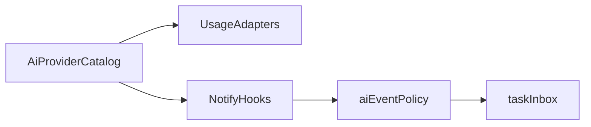

# 七家 AI：额度与完成统一接入

日期：2026-10-19。基线：`dev` / `e6eeda8`。状态：技术方案，待分期实施；本文不代表业务功能已上线。

## 已定决策

- **1C**：`grok`（xAI 独立）与 `grokbot`（Cursor/Anysphere 会话池）各一张卡；设置写清归属，避免与 Cursor 主额度重复解读。
- **2C**：一次成型统一注册表 + 能力矩阵；额度与完成可不同步；只合入已验证能力，其余标 unsupported/partial。

稳定来源 ID：`codex`、`claude`、`cursor`、`grok`、`grokbot`、`antigravity`、`copilot`、`manus`。

## 原则

参考 [CodexBar](https://github.com/steipete/CodexBar)、[QuotaBar](https://github.com/gentpan/QuotaBar)、[Pulse](https://github.com/qunqin24/Pulse)、[aiusg](https://github.com/abnegate/aiusg) 几乎只做额度。Pome 完成通道是本机 `127.0.0.1:43821/notify/<source>` + hook。

- 额度：借鉴端点与本机凭据发现，在 Node/Electron 内重写（safeStorage、host 白名单、超时、不写回第三方 CLI 凭据）；不嵌入 Swift/Rust，不依赖另装菜单栏 App。
- 完成：继续 hook → 转发脚本 → HTTP → taskInbox；新来源须有可信本机终态信号才进白名单。
- 不做：主动窥探对方窗口是否跑完；公网 webhook 直收；未验证标 verified。

## 架构（先骨架）

1. 扩展 `renderer/ai-provider-registry.js`（或上提共享 catalog）：每项含 id、label、usage/completion/attention 能力位、归属说明（grok vs grokbot vs cursor）。
2. 能力矩阵对齐 `aiSourceHooks.js` 的 verified|partial|unsupported；设置里额度与完成共用同一列表。
3. 泛化额度管道：`renderer/ai-usage.js`、`renderer/ai-usage-domain.js` 去掉硬编码双栏；按 registry 动态列出 available 来源；统一快照形状；大于 2 家时用主选切换或可滚动列表。
4. 完成管道目录化：`aiEventPolicy.js`、`taskInbox.js`、main 白名单、`aiSourceHooks.js`、图标与 i18n；旧 gpt 历史仍显示为其他；未验证 source 不接收 HTTP。
5. 设置：同一来源行展示两列能力；completion 用一键接入 hook；usage 用 Token/导入；grokbot 注明依赖 Cursor 登录；grok 注明 xAI 独立。

## 目标能力（未验证前保持 unsupported）

- cursor：额度已有；完成已有 stop/afterAgentResponse。
- codex：额度与完成已有。
- claude：完成已有；额度新增（aiusg 风格 OAuth usage + 本机登录发现）。
- grokbot：额度从 Cursor 池升格独立卡（GetSandUsageStatus）；完成 unsupported。
- grok：额度走 xAI billing/credits + 本机发现；刷新不写回对方 CLI；完成 unsupported 直至有 hook 样本。
- copilot：额度走 GitHub copilot_internal/user；完成 unsupported 直至 VS Code/CLI 终态可验证。
- antigravity：额度走本地 LS/agy 或 OAuth retrieveUserQuotaSummary（CodexBar 文档路径）；完成 unsupported 直至本机终态可验证。
- manus：额度走官方 usage.availableCredits + API Key（safeStorage）；完成因公网 webhook 与回环冲突，首版固定 unsupported。

## 分期

**P0 骨架**：catalog + 矩阵；现有 Cursor/Codex/Claude 迁入；额度 UI 支持 N 家；改双栏硬编码测试。

**P1 额度**：先 grokbot 独立卡 + Claude 额度；再按验证顺序 copilot → grok → antigravity → manus。

**P2 完成**：白名单改目录驱动；维持现有三家；每新增一家前隔离 fixture + 真机样本后再开。grokbot/manus 完成默认长期 unsupported。

**P3 文档**：README/CHANGELOG 矩阵、参考仓致谢（接口知识）、i18n、归属说明。

## 明确不做

- 为凑齐完成而接 Manus 公网 webhook。
- 整包嵌入 QuotaBar/Pulse。
- 用静默窗/未读替换冒充只推最终结果（另案）。
- 未验证标 verified。
