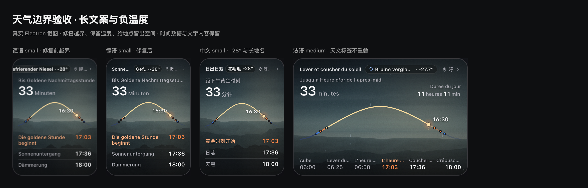
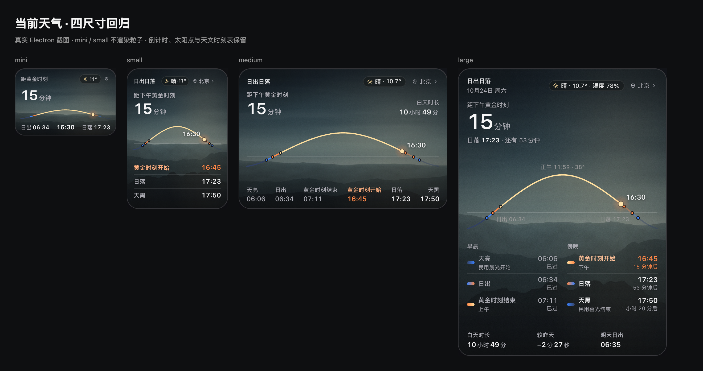
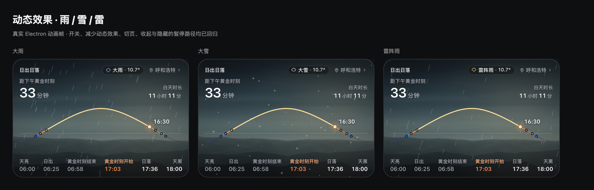

# 天气功能深度复查与修复

分支 `dev`，基于 `724cf92` 复查。没有修改顶栏或天文计算，也没有更换天气源、增加预报或提示弹窗。

## 已确认的问题

| 问题 | 触发与影响 | 修复 |
| --- | --- | --- |
| 两层刷新时钟相互延后 | 读到 29 分钟前的磁盘缓存时，界面又从当前时刻计半小时；两分钟后再唤起仍不刷新 | 删除界面的第二套限频，由主进程按持久化请求时间统一判断；相同地点仍合并并发请求 |
| 请求失败也重建卡片 | 主进程返回保留的成功值，界面仍重建 DOM 与粒子场景 | 比较读数与成功时间；缓存命中或失败回退到同一值时保留 DOM 和动画场景 |
| 多语言桥接保留旧双语白名单 | 八种新增语言的广播被 preload 过滤，尤其影响独立通知窗口；设置页能直接消费操作结果，掩盖了这个问题 | preload 校验消息结构，支持语言仍由共用 localization runtime 校验；启动值和广播均不再限制为中英文 |
| 天气长文案越过卡片边界 | 德语冻毛毛雨加负温度时，small 卡片标题被挤出画面；原断言只比较内层文字尺寸，不能保证父胶囊容纳 | 状态名与温度分开布局，胶囊宽度扣除地点空间；先省图标，必要时省略长状态；温度不缩，地点仍可省略，悬停和无障碍提供完整文案 |
| 原有天文翻译重叠 | 法语 medium 的事件名相互叠加，俄语 large 的事件名压住时刻 | 保留各时刻和原文，对过长标签使用省略号及完整标题；非中文中号时刻表等分列宽 |
| 异常天气值校验不一致 | 缓存接受 999°C / 178% 等越界数值；风速换算会把字符串当数字、把缺失值变为零 | 缓存复用接口数据的范围校验；风速先验证数字，再换算单位；异常缓存不阻挡重新获取 |
| 空坐标变成 `(0, 0)` | 手填空白以及缓存中的 null / 布尔值被数字转换误认为零 | 经纬度统一解析，拒绝空白、缺失、类型错误和越界，保留用户明确输入的合法 `0`；非法输入不保存也不请求天气 |
| HTTP 异常未释放响应体 | 429 / 上游故障时未消费的响应体可能占用连接 | 错误分支主动取消响应体，仍不显示接口错误 |
| 设置重试成功仍留下错误 | 开关保存失败后的错误说明没有在重试成功时清除 | 失败回滚复选框与实际设置，成功重试清除旧错误 |

## 相关改动

- `sunWeather.js`：缓存与风速校验。
- `renderer/sun.js`：手填和缓存经纬度共用的解析规则。
- `renderer/sun-widget.js`：主进程统一限频、失败/缓存无变化时不重绘、胶囊拆分与适配、天文标签完整标题。
- `renderer/weather-domain.js`：向视图提供独立的状态、温度、湿度字段。
- `renderer/styles.css`：胶囊与地点的宽度分配、温度保护、天文长标签防重叠；全部限定在日出日落模块内。
- `preload.js`：十语言初始化与广播消息校验。
- `renderer/workspace.js`：天气开关保存重试成功时清除旧错误。
- `tests/sun-weather.test.js`、`tests/sun-weather.electron.js`、`tests/localization.test.js`、`tests/localization.electron.js`：复现与回归。

## 验收

- 新增 29 分钟磁盘缓存场景：首次唤起不联网，过两分钟再次唤起必须联网。修复前稳定复现仍显示旧温度，修复后通过。
- 扩展到十语言 × 四尺寸，使用长城市名、冻毛毛雨及 -27.7°C；校验胶囊在卡片内、与地点无重叠、温度没有被父级裁切。中文 small 保留完整紧凑天气名。
- 单独检查自然短状态「晴」：有空间时保留图标和 large 湿度；仅在实际文字截断或总宽度不足时减少装饰，避免把短词自身的宽度误认为空间不足。
- 请求失败保留既有 `.wx` DOM 引用；继续验证 30 分钟内不重复请求、持续展开不轮询、切地点迟到结果不覆盖、全部特效族、开关、reduced motion、切页/收起/隐藏时停止。
- preload 单元回归覆盖十语言启动值、广播、无效消息、冻结与退订；真实 Electron 通知窗口另测德语广播，事件身份和用户原文保持。
- 边界回归覆盖空白、null、布尔、越界和合法零坐标；实际表单验证不发请求、不改变地点。10 秒超时测试使用模拟时钟，验证合并请求被释放、旧值保留、半小时内不重试、下次可恢复。另覆盖 429 体取消、缓存读写异常、系统时钟回退与开关保存失败/成功重试。
- 最终自动检查结果与截图见下方交付记录。
- 使用隔离用户目录及 mock keychain，不改实际 AI 配置、工作区或 NAS 数据。Windows 真机与安装包未验证，没有打包发布。

最终截图见 `screenshots/sun-weather-audit/`。截图使用固定天气数据，不代表当时真实天气。

## 最终交付验证

- `npm test` 完整结束，902 项 Node 测试：901 通过、1 项平台条件跳过、0 失败；所有 Electron 场景、进程重启及 JavaScript 语法检查通过。
- 本轮相关单测 54 项通过。官网 23 项测试、lint、十语言静态页面的生产构建通过。`i18n:check`、`git diff --check` 通过。
- 版本检查：`package.json`、`package-lock.json` 仍为 `0.11.0`，修复记录在未发布区；README 和官网仍使用当前 Releases / latest 动态下载入口，本次不创建版本标签、不发布安装包。
- 窗口 CSS 内容区 1240 × 638；四种卡片为 190 × 126 / 190 × 264 / 392 × 264 / 392 × 540 CSS px。本轮实际 PNG 为 2 倍密度。比较拼图将早期 190 × 264 与修复后 380 × 528 的小号图统一显示为 190 CSS px 宽。
- 完整回归日志：`/private/tmp/pome-weather-boundary-full.log`；专项单测：`/private/tmp/pome-weather-boundary-unit.log`；官网：`/private/tmp/pome-weather-boundary-website.log`、`/private/tmp/pome-weather-boundary-website-build.log`。
- 最终短状态图标/湿度判断调整后，追加天气、日出日落与语言通知的 Electron 验收及 54 项相关单测；日志 `/private/tmp/pome-weather-push-final.log`、`/private/tmp/pome-weather-push-final-unit.log`。

[空坐标表单校验](screenshots/sun-weather-audit/location-validation.png) · [保存失败回滚](screenshots/sun-weather-audit/settings-save-error.png) · [德语通知广播](screenshots/sun-weather-audit/german-awaiting.png)
