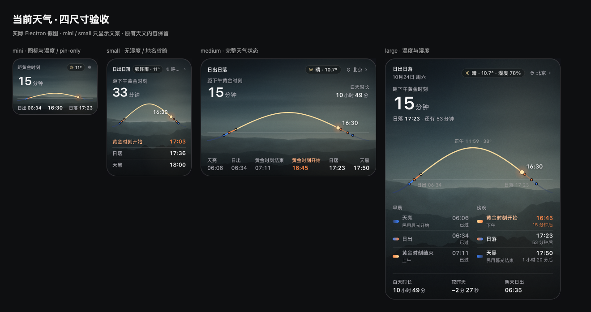
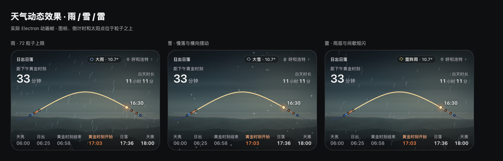

# 首页当前天气：实现与验收

2026-10-24，开发分支 `dev`。按方向 A · r2 定稿实施；只改日出日落卡片内部与设置页，顶栏和原有天文计算不变。

后续缓存时钟、无变化重绘、十语言广播与长文案修复见 [深度复查记录](weather-audit-2026-10-24.md)。

## 数据与刷新

- `sunWeather.js` 只接受有效经纬度，固定请求 Open-Meteo HTTPS current 接口：温度、相对湿度、WMO 天气码和 10 米风速。不请求逐小时或多日预报。
- 地点复用 `notch-sun-location-v1`，每个地点最近一次请求间隔至少 30 分钟；同一地点并发请求合并。首次唤起、重新展开或回到可见首页时检查时效，不设置天气轮询定时器。持续打开或收起超过半小时均不主动请求。
- 失败静默保留该地点最近成功值；首次失败显示空态，半小时内不重复请求。HTTP 错误、超时、非法 JSON、异常数据均不弹提示。切换地点时拒绝旧地点的迟到响应。
- 主进程缓存 `userData/sun-weather-cache.json`，最多 16 个地点；保存请求时间和成功数据，重启保留限频。缓存、地点和动效开关均为本机状态，不写入 NAS 工作区。
- 风速统一 km/h：`WIND_KMH = 25`，`STRONG_WIND_KMH = 40`。雨天保持主天气文案，只叠加风的运动。
- 当前指定接口没有雾霾、沙尘、雨夹雪专用 WMO 码。这三个独立文案、图标和动画支持显式 `condition` 兜底输入，并用受控数据验收；正式接口没有对应信息时不会仅凭温湿度猜测。正常 Open-Meteo 响应仍按实际 WMO 码显示。

来源：[Open-Meteo current API](https://open-meteo.com/en/docs)。设置页天气开关下显示提供方链接。

## 视图与生命周期

`renderer/weather-domain.js` 负责映射与四尺寸文案；`weather-icons.js` 复用 r2 原始 SVG；`sun-widget.js` 接入现有卡片。

- medium/large：`.sun-right` 按天气、地点顺序布局；large 补充湿度。
- mini：图标与取整温度，地点 pin-only；small 缩短天气名，必要时省图标，给地名保留完整字符与省略号空间。布局测量使用未变换宽度，避免布局动画期间错误裁切。
- 原有倒计时、太阳弧线、太阳点和时刻表保持。卡片内容 z-index 3；天空后的 canvas 为 z-index 2，不拦截点击。
- 「本机与唤出」只新增 `weatherEffects` 开关，默认开启；采用既有 app settings / IPC / settings changed 通路。关闭只停止粒子，不隐藏天气文案。
- `requestAnimationFrame` 驱动单卡 canvas，DPR 上限 2；切天气族清空重建。mini/small、离开首页、模块隐藏、面板收起、`document.hidden` 或 reduced motion 时拆 canvas 并停止帧循环；销毁时解绑媒体查询和观察器。

## 运动规格

实现集中在 `renderer/weather-effects.js`，时间和速度均使用秒与 CSS 像素。

| 特效族 | 运动与密度 |
| --- | --- |
| none | 不创建粒子层 |
| fog / haze | 白色 / 黄褐径向薄雾，0.18–0.32 缓慢呼吸，周期 7 / 8 秒；12 秒横向 ±2% |
| dust | 暖色薄雾与 14 个水平短条，20–40 px/s |
| drizzle | 14 根微斜短线，40–70 px/s |
| rain-light / mid / heavy | 22 / 42 / 72 根斜线，约 -15°，速度依次 55–70 / 80–100 / 110–130 px/s |
| snow-light / mid / heavy | 16 / 30 / 48 个软点，25–55 px/s；横摆振幅 6–14px，周期 2–4 秒 |
| sleet | 22 根小雨线与 12 个雪点 |
| thunder | 中雨层；每 4–8 秒一次 140ms 短闪，峰值透明度 0.22，无音效 |
| hail | 30 个较实方点，100–160 px/s |
| wind / wind-strong | 10 / 16 片低对比度扁平风片，基础速度 50–80 / 80–125 px/s；基础透明度约 0.035–0.058 / 0.052–0.075（在用户认可的淡风版本上提高 15%），纹理与局部消散进一步降低实际透明度；无明亮中脊或分叉烟缕，仅轻微横向形变、剪切与局部消散；柔边纹理缓存复用 |
| rain-wind | 中雨线保持 -25°，叠加 6 片透明度降低的风片，沿用相同形变与消散 |

## 改动文件

| 范围 | 文件 |
| --- | --- |
| 数据、设置与 IPC | `sunWeather.js`、`main.js`、`main-services.js`、`preload.js` |
| 四尺寸 UI、动画与设置 | `renderer/sun-widget.js`、`weather-domain.js`、`weather-icons.js`、`weather-effects.js`、`index.html`、`styles.css`、`workspace.js` |
| 十语言资源 | `localization/locales/*.json` 及生成的桌面/NAS 资源 |
| 回归与发布文件清单 | `tests/sun-weather.test.js`、`sun-weather.electron.js`、`layout.test.js`、`provider-usage-fixtures.cjs`、`scripts/test-desktop.js`、`package.json` |
| 产品说明 | 中英文 README、CHANGELOG、user-guide 与根目录 `design-qa.md` |

## 验收证据

- `npm test`：896 项 Node 测试，895 通过、1 项平台条件跳过、0 失败；Electron 集成及语法检查通过。
- 最终天气 Electron 回归再次通过：四尺寸、长文案/长地点、30 分钟唤起规则、静默失败、切地点竞态、全部特效族、开关持久化、图层、reduced motion、窗口隐藏和收起/切页暂停。
- 相关领域回归 98 项通过；最终天气与布局回归 25 项通过。十语言 `i18n:check` 通过；官网 23 项测试与 lint 通过。
- 单独请求一次真实 Open-Meteo current 成功；展示帧使用固定天气数据与隔离用户目录，便于复现，不代表截图当时真实天气。
- 没有打包或安装新版，Windows 真机、Windows 系统减少动态效果和安装包验证尚未做。未访问或改写实际用户工作区、NAS 配对与 AI 凭据。

[设置页截图](screenshots/sun-weather/settings.png) · [r2 与实际界面对照](screenshots/sun-weather/design-comparison.png)
